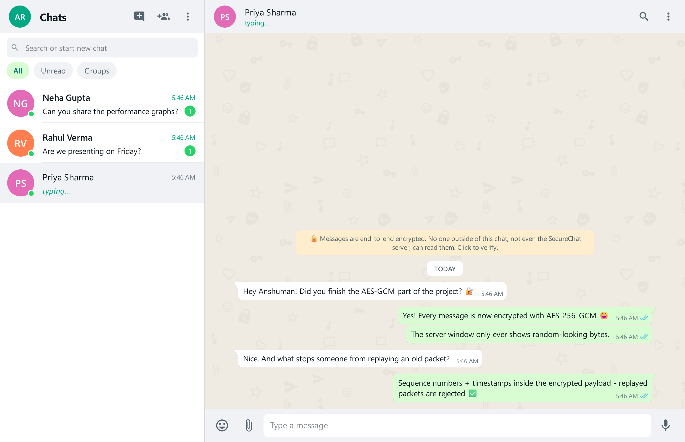
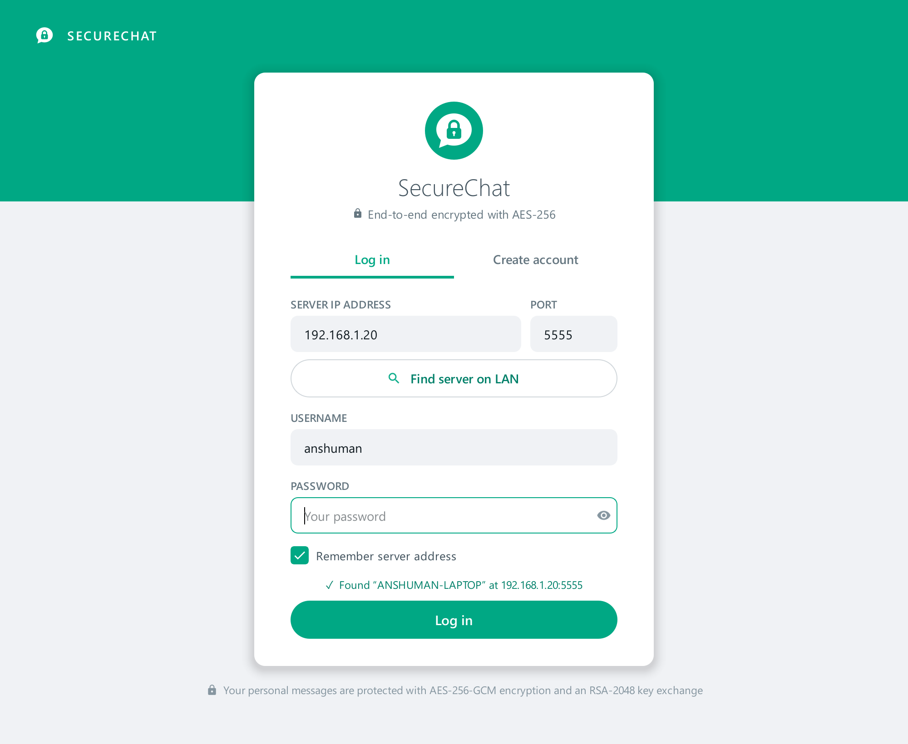
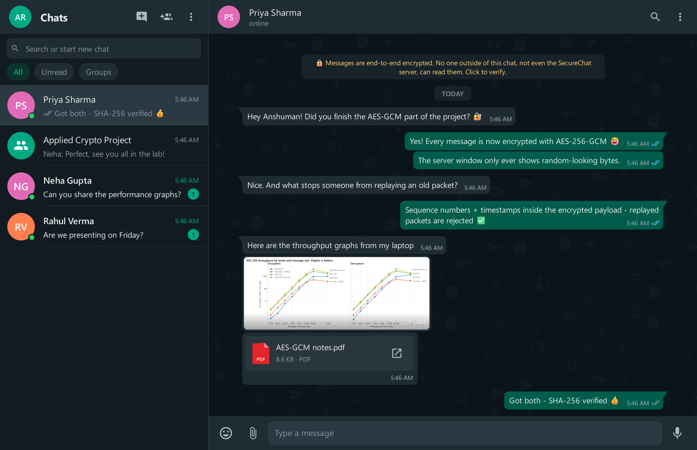
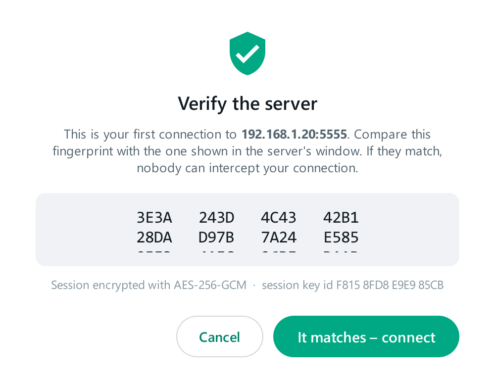
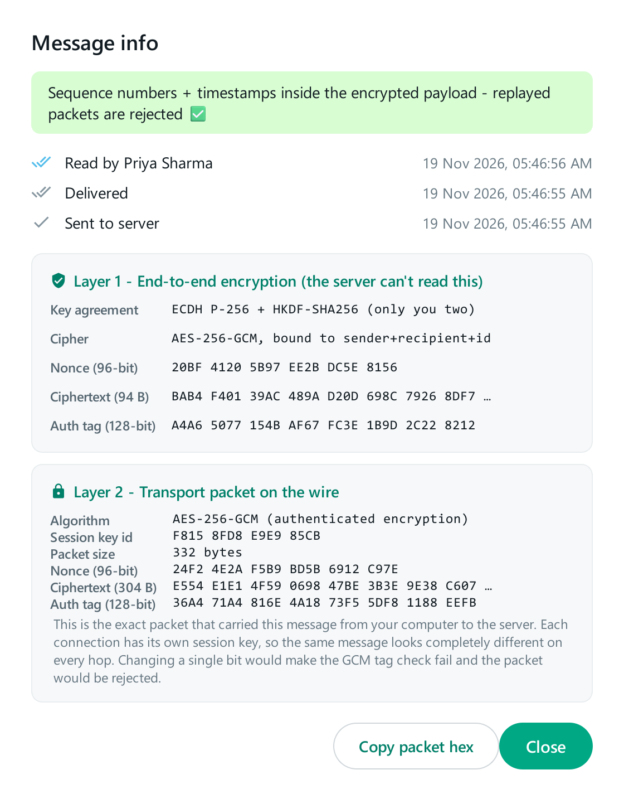
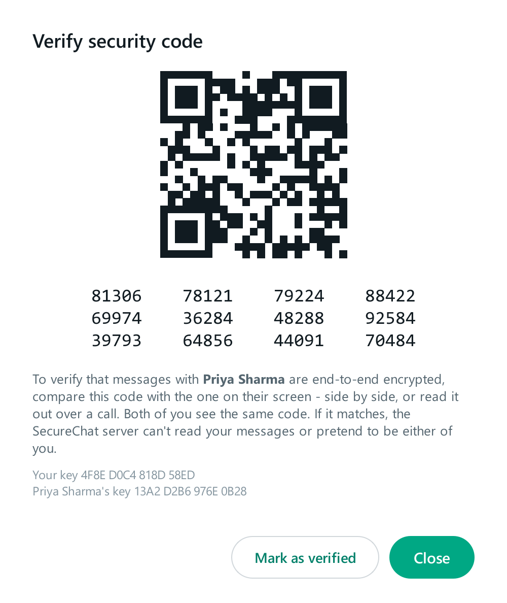
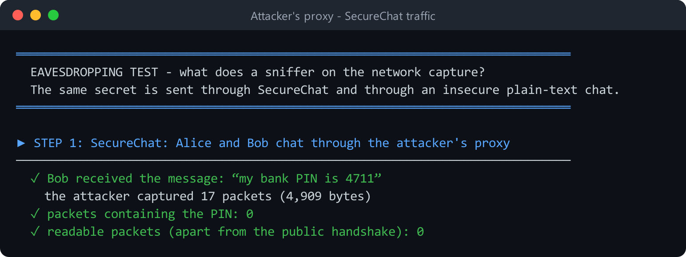
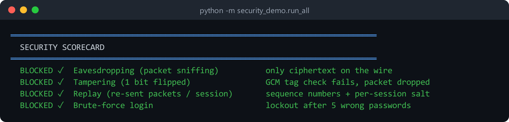
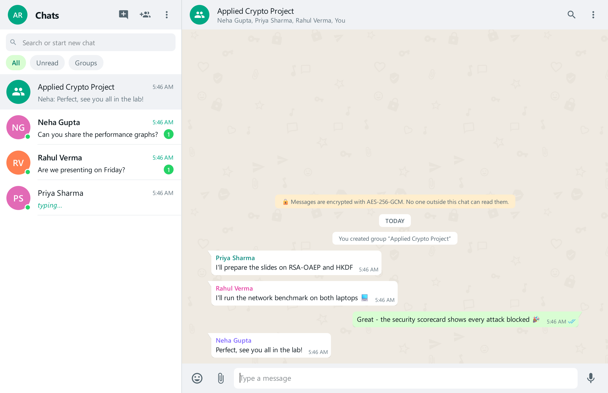

# 🔐 SecureChat — Secure Chat Application using AES Encryption

A client–server chat application in **Python** that uses **socket programming** and **PyCryptodome** to encrypt every message with **AES-256-GCM**. It has a **WhatsApp-style desktop interface** and runs across **two PCs or laptops** on the same network.

📕 **[Project report (PDF)](docs/SecureChat_Project_Report.pdf)** · 📄 [Technical report](docs/PROJECT_REPORT.md) · [Viva questions](docs/VIVA_QUESTIONS.md) · [Demo script](docs/DEMO_SCRIPT.md) · [Two-PC setup](docs/DEPLOYMENT.md) · [Performance report](performance/PERFORMANCE_REPORT.md)



---

**Repository:** [github.com/AnshumanRavi/secure-chat-aes](https://github.com/AnshumanRavi/secure-chat-aes)

---

## ⚡ Quick Start

### On one PC (fastest way to try it)

1. Install **Python 3.11 or newer** from [python.org](https://www.python.org/downloads/) — tick **"Add python.exe to PATH"**.
2. Get the code: `git clone https://github.com/AnshumanRavi/secure-chat-aes.git` (or *Code → Download ZIP* on GitHub).
3. Double-click **`run_server.bat`**. The first run creates a private Python environment (`.venv`) and installs the requirements (needs internet once, 2–3 minutes), then asks you to choose a **passphrase** for the server's key.
4. Double-click **`run_client.bat`** — twice, for two users.
5. In each window: **Find server on LAN** (or server `127.0.0.1`, port `5555`) → **Create account** (e.g. `alice` and `bob`) → compare the fingerprint with the server window → **It matches – connect**.
6. Start chatting.

### On two PCs

| PC 1 (server) | PC 2 |
|---|---|
| `run_server.bat` — note the address after `>>> Clients on other PCs should connect to:` | `run_client.bat` → **Find server on LAN**, or type that address |
| Once, as administrator: `allow_firewall.bat` | — |

Firewall, hotspots and troubleshooting: **[docs/DEPLOYMENT.md](docs/DEPLOYMENT.md)**. No Python on PC 2? Build `SecureChat.exe` with PyInstaller (same guide).

### Without the batch files (any OS)

```
python -m venv .venv
.venv\Scripts\activate                (Linux/macOS: source .venv/bin/activate)
pip install -r requirements.txt
python -m server.server                (terminal 1)
python -m client.gui.main              (terminal 2, and again in terminal 3)
```

### Other useful commands

| Command | What it does |
|---|---|
| `python -m pytest` | Runs the 287 automated tests |
| `python -m security_demo.run_all` | Eavesdropping, tampering, replay and brute-force attacks → scorecard (all blocked) |
| `python -m security_demo.sniffer_proxy` | The "attacker in the middle" — connect a client to port 6666 and watch the ciphertext |
| `python -m performance.benchmark_crypto` | AES modes, key sizes, handshake and PBKDF2 benchmarks + graphs |
| `python -m performance.benchmark_network` | SecureChat vs a plaintext chat: latency, throughput, scalability, files (`--remote <ip>` for two PCs) |
| `python -m performance.make_report` | Rewrites `performance/PERFORMANCE_REPORT.md` from the measured results |

---

## ✨ Features

**Security**
- 🔒 **AES-256-GCM** on every packet: a fresh random 96-bit nonce per packet and a 128-bit authentication tag — tampered packets are rejected
- 🔑 **RSA-2048-OAEP + HKDF** handshake: a new AES session key for every connection, key confirmation, server **fingerprint pinning** against man-in-the-middle attacks
- 🔁 **Replay protection**: sequence numbers, timestamps (±60 s), per-session salt and direction-bound associated data
- 🧂 **PBKDF2-HMAC-SHA256** password hashing with a salt, account lockout, no username enumeration, single-use reconnect tokens
- 🛡️ Optional **end-to-end encryption** (ECDH P-256) for one-to-one chats, with a WhatsApp-style **60-digit security code**
- 💾 Encrypted **offline queue** on the server and encrypted **chat history** on each PC
- 📎 File integrity with **SHA-256**; file names cleaned against path traversal and extension spoofing

**Chat (WhatsApp-style)**
- One-to-one and **group chats**, ✓ / ✓✓ / blue ✓✓ ticks, *typing…*, online and last seen
- **Images and documents** up to 25 MB with thumbnails and progress
- Emoji picker, search (in a chat and across all chats), *Message info* showing the real encrypted packet
- **Light and dark themes**, wallpapers, desktop notifications, automatic reconnect with resend of pending messages

**Proof and evaluation**
- Attack tools: packet sniffer / man-in-the-middle proxy, tamper, replay and brute-force demos with a scorecard, plus a deliberately insecure chat for comparison
- Benchmarks with graphs and a generated **performance report**; **287 tests**

### Screenshots

| Login | Chat | Dark mode |
|---|---|---|
|  |  |  |
| **Verify the server** | **Message info (the encrypted packet)** | **Security code (E2E)** |
|  |  |  |
| **Attacker's view** | **Security scorecard** | **Group chat** |
|  |  |  |

*(Screenshots are taken from the real app by `python -m docs.tools.make_screenshots`; `python -m docs.tools.build_pdf` rebuilds the PDF report.)*

---

> **How this project was built:** the second half of this README is the **build guide** — 21 prompts given to Claude one at a time, in order. Each prompt builds one part of the project and has a check to run before moving on.

---

## 📌 Project Summary

| Item | Details |
|---|---|
| **Title** | Secure Chat Application using AES Encryption |
| **Goal** | Build a secure client–server chat app that uses AES encryption |
| **Hardware** | Two PCs/laptops on the same Wi-Fi/LAN (one also runs the server) |
| **Language** | Python 3.11+ (tested with 3.13) |
| **Networking** | Python `socket` + `threading` (TCP) |
| **Cryptography** | PyCryptodome: AES-256-GCM, RSA-2048-OAEP key exchange, PBKDF2 password hashing |
| **GUI** | PySide6 (Qt), styled like WhatsApp Desktop/Web |
| **Storage** | SQLite (users on the server, encrypted chat history on the client) |
| **Evaluation** | `matplotlib`, `psutil`, `time.perf_counter` benchmarks |

### How the project tasks map to features

| Required task | How this project does it |
|---|---|
| Client–Server Communication | Multi-threaded TCP server; clients connect over the LAN; JSON messages with a length prefix |
| AES Encryption | Every packet after the handshake is encrypted with AES-256-GCM using a fresh random nonce |
| AES Decryption | The receiver decrypts and checks the GCM authentication tag; tampered packets are rejected |
| Secure Messaging | RSA key exchange, a per-session AES key, hashed passwords, replay protection, optional end-to-end mode, and a packet-sniffer demo |
| Performance Evaluation | Benchmarks of AES modes, key sizes, message sizes, latency and throughput, encrypted vs plaintext, with graphs and a report |

---

## 🏗️ Architecture

```
   PC 1 (Server + Client A)                         PC 2 (Client B)
 ┌──────────────────────────┐                  ┌──────────────────────────┐
 │  WhatsApp-style GUI (A)  │                  │  WhatsApp-style GUI (B)  │
 │          │               │                  │          │               │
 │  Client networking +     │                  │  Client networking +     │
 │  AES-256-GCM crypto      │                  │  AES-256-GCM crypto      │
 └──────────┬───────────────┘                  └──────────┬───────────────┘
            │  encrypted TCP                              │  encrypted TCP
            ▼                                             ▼
 ┌─────────────────────────────────────────────────────────────────────┐
 │                       SecureChat Server (PC 1)                       │
 │  RSA key pair · per-client AES session keys · auth (PBKDF2+SQLite)  │
 │  message routing · presence · groups · replay protection · logs     │
 └─────────────────────────────────────────────────────────────────────┘
```

### Handshake and secure session

1. The client connects. The server sends its **RSA-2048 public key** and a fresh random **16-byte salt**. The client checks the key's **fingerprint**, which can be pinned.
2. The client creates a random **256-bit secret**, encrypts it with **RSA-OAEP (SHA-256)**, and sends it.
3. Both sides compute the **AES-256 session key = HKDF-SHA256(secret, salt)**. Because the server's salt is new each time, a recorded session replayed later produces a different key and fails.
4. The server sends an encrypted `HANDSHAKE_OK` to prove it has the same key (key confirmation).
5. From then on, every packet is: `[4-byte length][12-byte nonce][ciphertext][16-byte GCM tag]`.
6. Inside the encrypted payload, every message carries its **type + sequence number + timestamp** to block replay attacks. The GCM associated data is `SecureChat/1|C2S` or `SecureChat/1|S2C`, which ties each packet to its direction so it cannot be reflected back.
7. Login and registration happen **inside** the encrypted tunnel. Passwords are stored as **PBKDF2-SHA256 hashes with a salt**.
8. **Optional end-to-end mode:** clients agree on a key with each other, so even the server cannot read messages.

---

## 📁 Folder Structure

```
Cryptography Project/
├── README.md                  ← this file
├── requirements.txt           ← runtime libraries (+ requirements-dev.txt, requirements-build.txt)
├── config.json                ← port, size limits, timeouts
├── run_server.bat / run_client.bat / setup_env.bat / allow_firewall.bat
├── common/
│   ├── crypto_utils.py        ← AES-GCM, RSA-OAEP, HKDF, PBKDF2, fingerprints
│   ├── protocol.py            ← framing, message types, SecureChannel, handshake
│   ├── e2e.py                 ← end-to-end keys (ECDH P-256), security code
│   ├── discovery.py           ← "Find server on LAN" (UDP broadcast)
│   └── config.py, console.py
├── server/
│   ├── server.py              ← multi-threaded server: routing, groups, files, offline queue
│   ├── auth.py                ← registration/login, PBKDF2, lockout, resume tokens
│   ├── database.py            ← SQLite (users, groups, sessions, encrypted offline messages)
│   └── security_log.py
├── client/
│   ├── network.py             ← ChatClient: handshake, events, reconnect, files, E2E
│   ├── local_store.py         ← encrypted local chat history
│   ├── files.py, formatting.py, cli_client.py
│   └── gui/
│       ├── main.py, login_window.py, main_window.py, chat_store.py, ...
│       ├── widgets/ (chat_list, chat_view, bubble, file_bubbles, input_bar, security_code, ...)
│       ├── styles/ (light.qss, dark.qss)
│       └── assets/
├── security_demo/             ← sniffer/MITM proxy, insecure chat, tamper, replay, brute force, run_all
├── performance/               ← benchmarks, results/ (CSV), graphs/ (PNG), PERFORMANCE_REPORT.md
├── packaging/                 ← PyInstaller spec for standalone .exe files
├── tests/                     ← 287 pytest unit, integration, GUI and attack tests
└── docs/
    ├── PROJECT_REPORT.md, VIVA_QUESTIONS.md, DEMO_SCRIPT.md
    ├── DEPLOYMENT.md, WIRESHARK_GUIDE.md
    └── screenshots/
```

---

## 🎨 WhatsApp UI Reference (used in the UI prompts)

| Element | Light theme | Dark theme |
|---|---|---|
| App/side header | `#F0F2F5` | `#202C33` |
| Sidebar background | `#FFFFFF` | `#111B21` |
| Chat wallpaper | `#EFEAE2` (with a light doodle pattern) | `#0B141A` |
| Outgoing bubble | `#D9FDD3` | `#005C4B` |
| Incoming bubble | `#FFFFFF` | `#202C33` |
| Accent / send button | `#00A884` | `#00A884` |
| Read ticks ✓✓ | `#53BDEB` | `#53BDEB` |
| Primary text | `#111B21` | `#E9EDEF` |
| Secondary text | `#667781` | `#8696A0` |
| Unread badge | `#25D366` | `#00A884` |

**Layout:** left sidebar (≈30%) with a profile header, search bar, filter chips (All / Unread / Groups) and a chat list. Right pane (≈70%) with a chat header (avatar, name, "online / typing… / last seen"), the scrolling message area, and an input bar (emoji 😊, attach 📎, text box, send ➤ / mic 🎤).

---

## 🚀 How to Use This Guide

1. Open this folder in VS Code with Claude Code.
2. Copy **Prompt 1**, paste it to Claude, and let it finish.
3. Run the **✅ Check** for that step. If something fails, tell Claude what you saw (paste the error).
4. Go to the next prompt. **Don't skip steps.** Later prompts depend on earlier ones.
5. Every prompt starts with "Read README.md…", so it still works if you start a new chat session.

> 💡 Tip: After each working step, back up the folder (or run `git init` once and commit after each step). If a later step breaks something, you can roll back.

---

# 🧩 THE PROMPTS

## Phase 1 — Foundation

### Prompt 1 — Project setup

```
Read README.md in this folder. It is the master plan for my "Secure Chat Application using AES
Encryption" project. Set up the foundation:
1. Create the full folder structure shown in README.md (empty __init__.py files where needed).
2. Create requirements.txt with: pycryptodome, PySide6, matplotlib, psutil, pytest, emoji
   (pinned to recent stable versions).
3. Create config.json (server_host "0.0.0.0", client connects to "127.0.0.1" by default, port 5555,
   max message size, session timeout, log level) and common/config.py to load it, with CLI
   overrides for --host and --port.
4. Create a Python virtual environment (.venv), install the requirements, and confirm the imports work.
5. Add a .gitignore (venv, __pycache__, *.db, keys/, logs/).
I'm on Windows. Give me the exact commands to activate the venv.
```
**✅ Check:** `python -c "import Crypto, PySide6; print('OK')"` prints `OK`.

---

### Prompt 2 — Cryptography module (AES-256-GCM + RSA)

```
Read README.md. Build common/crypto_utils.py using PyCryptodome:
- generate_aes_key() → 32 random bytes (AES-256) using Crypto.Random.get_random_bytes
- aes_encrypt(key, plaintext_bytes, associated_data=None) → nonce(12) + ciphertext + tag(16), AES-GCM mode
- aes_decrypt(key, blob, associated_data=None) → plaintext; raises a custom IntegrityError if the
  tag check fails (tampering)
- RSA-2048: generate/save/load key pair (PEM, private key protected with a passphrase), and
  rsa_encrypt/rsa_decrypt using PKCS1_OAEP with SHA-256
- public_key_fingerprint(pubkey) → SHA-256 hex, formatted in groups like "A1B2 C3D4 ..."
- hash_password(password) / verify_password(password, stored) using PBKDF2-HMAC-SHA256,
  16-byte salt, 200,000 iterations, constant-time compare
- derive_key_from_password(password, salt) for encrypting local data
Also add AES-CBC (with PKCS7 padding + HMAC), AES-CTR and AES-ECB helpers, used ONLY for the
performance comparison later. Mark ECB clearly as insecure.
Add clear docstrings explaining each cryptographic choice (good for my viva). Write
tests/test_crypto.py with pytest: encrypt/decrypt round trip, tamper detection, wrong key fails,
unique nonces, RSA round trip, password hashing. Run the tests.
```
**✅ Check:** `pytest tests/test_crypto.py -v` shows all tests passing.

---

### Prompt 3 — Secure protocol and packet framing

```
Read README.md and common/crypto_utils.py. Build common/protocol.py:
- Length-prefixed framing over TCP: 4-byte big-endian length header, then the body. Write
  send_frame(sock, bytes) and recv_frame(sock) that handle partial reads with a max frame size
  limit (reject oversized frames to prevent memory attacks).
- Message types as constants/Enum: HANDSHAKE_PUBKEY, HANDSHAKE_SESSION_KEY, REGISTER, LOGIN,
  AUTH_OK, AUTH_FAIL, CHAT_MSG, GROUP_MSG, DELIVERED, READ, TYPING, PRESENCE, USER_LIST,
  CREATE_GROUP, FILE_START, FILE_CHUNK, FILE_END, HISTORY, PING, PONG, ERROR, LOGOUT.
- A SecureChannel class that wraps a socket plus an AES session key:
  send(dict) → JSON-encode, add "seq" (increasing counter) and "ts" (timestamp), AES-GCM encrypt,
  send a frame. recv() → receive a frame, decrypt, verify the tag, reject if seq <= last seen seq
  (replay) or ts is more than 60 s off (stale). Use the message type as GCM associated data.
  Thread-safe send (lock).
- Handshake functions for the server side and the client side (RSA-OAEP key transport as
  described in README.md).
Write tests/test_protocol.py using socket.socketpair() to test the handshake, send/recv, replay
rejection and tamper rejection. Run the tests.
```
**✅ Check:** `pytest tests/ -v` passes.

---

## Phase 2 — Client–Server Communication

### Prompt 4 — Multi-threaded server

```
Read README.md and the common/ modules. Build the server:
- server/database.py: SQLite with tables users(username, display_name, password_hash, about,
  avatar_color, created_at, last_seen), groups, group_members, offline_messages (store the
  encrypted blob only).
- server/auth.py: register (validate username/password strength) and login (PBKDF2 verify,
  lock out after 5 failed attempts for 60 s).
- server/server.py: TCP server on config host/port; one thread per client; RSA key pair is
  created on first run and saved in keys/; on start it prints the server IP addresses on the
  LAN and the key fingerprint. For each client: handshake → auth → message loop. It keeps an
  online-users dict and routes CHAT_MSG from sender to recipient (decrypt with the sender's key,
  re-encrypt with the recipient's key). If the recipient is offline, store the message and
  deliver it on their next login. It sends DELIVERED receipts, broadcasts PRESENCE
  (online/offline, last_seen), and handles PING/PONG heartbeats, session timeouts and clean
  disconnects.
- server/security_log.py: log security events (failed logins, tamper attempts, replays) to
  logs/security.log, and show colorful console logs that show the ciphertext (hex, shortened)
  next to the event so I can demonstrate that encryption is happening.
Use graceful shutdown with Ctrl+C.
```
**✅ Check:** `python -m server.server` starts and prints its LAN IP, port and key fingerprint.

---

### Prompt 5 — Terminal client (for testing before the GUI)

```
Read README.md and the existing code. Build client/network.py (a reusable ChatClient class with
connect, handshake, register, login, send_message, a background receive thread, and
callbacks/events for incoming messages) and client/cli_client.py (a simple terminal chat:
register/login, /users to list online users, /msg <user> <text>, /quit). Show the key
fingerprint on connect.
Then write tests/test_integration.py that starts the server on a random port in a thread,
connects two clients, registers them, sends messages both ways, and checks that they arrive
decrypted correctly and that an offline message is delivered after login. Run it.
```
**✅ Check:** Open 3 terminals (1 server + 2 CLI clients) and chat between the two clients.

---

## Phase 3 — WhatsApp-Style GUI

### Prompt 6 — Login and register screen

```
Read README.md (especially the "WhatsApp UI Reference" section) and client/network.py. Using
PySide6, create client/gui/main.py and client/gui/login_window.py:
- A WhatsApp-Desktop-style welcome/login screen: teal (#00A884) top band, a centered white card
  with an app logo (a lock + chat-bubble icon drawn in code or SVG), the "SecureChat" title, the
  tagline "End-to-end encrypted with AES-256", and tabs for Login / Register.
- Fields: Server IP (default from config), Port, Username, Password (show/hide eye toggle),
  Display name (register only). Rounded inputs, green primary button, inline error labels, and
  a loading spinner while connecting.
- Connect using network.py in a QThread so the UI never freezes. After the handshake, show a
  popup with the server key fingerprint ("Verify this matches the server") before login.
- "Remember server address" checkbox (stored in a local settings file).
- On success, open the main window (a placeholder for now).
Put all styling in client/gui/styles/light.qss. The app must look modern, not like default Qt.
```
**✅ Check:** `python -m client.gui.main` shows a polished login screen, and login works against the running server.

---

### Prompt 7 — Main window: sidebar and chat list

```
Read README.md and the GUI code so far. Build client/gui/main_window.py and the widgets, the
same as WhatsApp Desktop:
LEFT SIDEBAR (~30% width, resizable splitter):
- Header: my circular avatar (initials on a colored background), "Chats" title, icons for new
  chat ➕, new group 👥, menu ⋮ (Settings, Dark mode toggle, Logout).
- Search bar "Search or start new chat" with a magnifier icon, rounded, gray background.
- Filter chips: All | Unread | Groups.
- Chat list (custom delegate or widgets): avatar, name, last-message preview (with ✓✓ if mine),
  time on the right, green unread-count badge, green dot for online users. Hover and selected
  states the same as WhatsApp. Sorted by latest message.
RIGHT PANE:
- With no chat selected: the WhatsApp-like intro panel ("SecureChat for Windows", a lock icon,
  "Your messages are end-to-end encrypted").
- With a chat selected: a header with avatar, name and status line ("online" / "last seen today
  at 10:42"), plus search and ⋮ icons. A placeholder message area for now.
Load the user list from the server (USER_LIST) and update presence in real time.
```
**✅ Check:** Log in from 2 clients. Each sees the other in the chat list with an online dot.

---

### Prompt 8 — Chat view, message bubbles and the input bar

```
Read README.md and the GUI code. Build the chat conversation view, the same as WhatsApp:
- Wallpaper background #EFEAE2 with a subtle doodle pattern (generate a tiled pattern
  programmatically or as an SVG asset).
- Message bubbles: outgoing on the right (#D9FDD3), incoming on the left (white), rounded
  corners with the small "tail" on the first bubble of a group, max width ~65%, word wrap,
  selectable text, time at bottom-right inside the bubble, and ticks for my messages:
  🕓 sending → ✓ sent → ✓✓ delivered (gray) → ✓✓ read (blue #53BDEB).
- Date separator chips ("TODAY", "YESTERDAY", "12/11/2026") and a yellow encryption notice chip
  at the top of each chat: "🔒 Messages are encrypted with AES-256-GCM. No one outside this chat
  can read them."
- Group consecutive messages from the same sender; auto-scroll to the bottom on a new message;
  a "scroll to bottom ↓" floating button with an unread count.
- Input bar: emoji button 😊 (opens an emoji picker grid with categories), attach 📎 (disabled
  for now), a multi-line growing text box ("Type a message"), and a send button ➤ that replaces
  the mic 🎤 when text is typed. Enter = send, Shift+Enter = new line.
- Right-click on a bubble: Copy, Message info (shows sent/delivered/read times plus the
  ciphertext hex and nonce for the demo), Delete for me.
Wire it to network.py: sending shows the bubble right away with a clock icon, then updates the
ticks when the server confirms.
```
**✅ Check:** Real-time chatting between two GUI windows with correct bubbles, times and ticks.

---

### Prompt 9 — Presence, typing, read receipts and notifications

```
Read README.md and the code. Add:
- A "typing…" indicator (send TYPING with a throttle, clear after 3 s of no input). Show it in
  the chat header status and in the chat-list preview (green italic "typing…").
- Read receipts: when a chat is open and visible, send READ for unread messages and turn the
  sender's ticks blue.
- Unread badges, a bold chat name for unread chats, and moving a chat to the top on a new message.
- Desktop notifications (QSystemTrayIcon message) plus a short notification sound when the
  window is not focused. A tray icon with an unread count.
- Last-seen formatting ("online", "last seen today at 9:41 PM", "last seen yesterday at...").
- Reconnect automatically with a "Connecting…" yellow banner if the server drops, and resend
  pending messages after reconnecting.
```
**✅ Check:** Typing in client A shows "typing…" on client B; opening a chat turns the ticks blue.

---

### Prompt 10 — Group chats

```
Read README.md and the code. Add encrypted group chats:
- A "New group" dialog: pick members with checkboxes and search, set a group name, an avatar
  color, and a description.
- Server: a CREATE_GROUP handler, store the group plus its members, and route GROUP_MSG to every
  member (re-encrypted per member's session key; offline members get it later).
- UI: groups in the chat list with a group icon; incoming group bubbles show the sender's name
  in a unique color (the same as WhatsApp); the header shows the member names; a group info panel
  slides in from the right (members, admin badge, Leave group).
- Group read status: ✓✓ blue only when all members have read the message.
- System messages ("Anshu created group 'Crypto Team'", "X left").
```
**✅ Check:** Create a group with both users and chat in it.

---

### Prompt 11 — Encrypted file and image sharing

```
Read README.md and the code. Enable the 📎 attach button:
- Attach menu: Document, Photo. Max 25 MB.
- Files are split into 64 KB chunks; every chunk is AES-GCM encrypted (FILE_START with metadata
  and a SHA-256 hash → FILE_CHUNK × N → FILE_END). The receiver checks the SHA-256 after
  reassembling.
- Image messages show a thumbnail inside the bubble (click to open a full-size viewer); documents
  show a file card with an icon, name, size and a download/open button. A progress ring while
  uploading/downloading.
- Drag and drop files onto the chat to send them.
- Received files are saved to a downloads/ folder.
Keep the UI responsive (do the transfer in a worker thread).
```
**✅ Check:** Send an image and a PDF between the two PCs; both open correctly.

---

### Prompt 12 — Encrypted local history, settings and dark mode

```
Read README.md and the code. Add:
- client/local_store.py: a per-user SQLite chat history where message contents are encrypted with
  AES-GCM using a key derived from the user's password (PBKDF2 + random salt stored in the DB).
  Load history when a chat opens (lazy-load older messages when scrolling up). Show that the
  .db file contents are unreadable without the password.
- A Settings dialog (WhatsApp-style left list: Profile, Privacy, Chats, Notifications, Security,
  About): edit display name and "About" text, choose a theme (Light / Dark / System), choose a
  chat wallpaper color, notification sound on/off, and a Security page showing the session key
  info (AES-256-GCM, a key fingerprint — NEVER the raw key), the server RSA fingerprint, and
  "Clear chat history".
- Full dark mode using client/gui/styles/dark.qss with the WhatsApp dark colors from README.md,
  switchable at runtime.
- Search inside a chat (highlight matches) and a global chat search in the sidebar.
```
**✅ Check:** Restart the client and log in again; the history is still there. Dark mode looks right.

---

## Phase 4 — Secure Messaging (protection and proof)

### Prompt 13 — Optional end-to-end encryption mode

```
Read README.md and the code. Add an optional true end-to-end encryption (E2EE) mode so the
server only relays ciphertext it cannot read:
- Each client creates an RSA-2048 (or ECC P-256 using PyCryptodome's ECC + ECDH-style key
  derivation with HKDF) identity key pair on registration and uploads only the PUBLIC key.
- For each 1-to-1 chat, the clients agree on a shared AES-256 key (wrap a random AES key with the
  recipient's public key, or derive it via ECDH + HKDF). Messages are AES-GCM encrypted with this
  key, then wrapped again by the transport channel (double encryption: E2E + transport).
- Show a "Security code" screen (like WhatsApp's "Verify security code"): a 60-digit number /
  QR-like grid built from both public keys, so users can compare them in person.
- Warn in the chat with a yellow system message if a contact's key changes.
- A toggle in Settings → Security: "End-to-end encryption" ON/OFF; the server console should show
  that it cannot decrypt E2E messages.
Explain in comments how this stops a compromised server from reading messages.
```
**✅ Check:** With E2E on, the server log shows only `[E2E ciphertext]` for message bodies.

---

### Prompt 14 — Security demonstration tools (prove unauthorized access fails)

```
Read README.md and the code. Build the security_demo/ folder for my presentation:
1. sniffer_proxy.py — a "man-in-the-middle" TCP proxy (listens on 6666, forwards to the server
   on 5555). Point a client at port 6666. It prints every captured packet as hex and tries to
   decode it as UTF-8, showing that the attacker sees only random-looking bytes. Add a
   --plaintext-mode comparison using a deliberately UNENCRYPTED demo server/client pair
   (security_demo/insecure_chat.py) so I can show the difference side by side.
2. tamper_test.py — the proxy flips one bit in a packet; show that the receiver rejects it with
   "GCM authentication failed — message tampered" and the server logs the event.
3. replay_test.py — capture a valid encrypted packet and resend it; show that it is rejected by
   the sequence number/timestamp check.
4. bruteforce_login_test.py — show the account lockout after 5 wrong passwords.
5. A step-by-step docs/WIRESHARK_GUIDE.md: how to capture traffic on port 5555 (filter
   tcp.port == 5555), "Follow TCP Stream", and what to screenshot for the report.
Each script prints colorful, well-labeled output that looks good on a projector.
```
**✅ Check:** Run each demo script; every attack is detected or blocked.

---

## Phase 5 — Performance Evaluation

### Prompt 15 — Cryptographic benchmarks

```
Read README.md and common/crypto_utils.py. Build performance/benchmark_crypto.py:
- Compare AES-128 / AES-192 / AES-256 key sizes.
- Compare modes: ECB (insecure baseline), CBC+HMAC, CTR, GCM.
- Message sizes: 16 B, 64 B, 256 B, 1 KB, 4 KB, 16 KB, 64 KB, 1 MB.
- Measure encryption time, decryption time and throughput (MB/s), with 1000 iterations each
  (use time.perf_counter, warm-up runs, and report mean ± std dev).
- Measure the RSA-2048 handshake cost, the PBKDF2 hashing time (and how it changes with
  iterations), and ciphertext overhead in bytes (nonce + tag + padding) per mode.
- Measure CPU % and memory (psutil).
Save the results to performance/results/*.csv and make clear matplotlib graphs in
performance/graphs/ (bar charts, line charts with log-scale x-axis, titled and labeled, 300 DPI)
with a print-friendly white style. Print a summary table in the terminal.
```
**✅ Check:** Graphs appear in `performance/graphs/`.

---

### Prompt 16 — Network performance (encrypted vs plaintext)

```
Read README.md and the code. Build performance/benchmark_network.py:
- Start the real server (and the insecure plaintext demo server) automatically.
- Measure the round-trip latency (send → server → echo/receipt) for encrypted vs plaintext
  messages at different sizes, average over 500 messages.
- Throughput test: send N messages as fast as possible; messages/second and MB/s.
- Scalability test: 1, 5, 10, 25, 50 concurrent simulated clients; average latency and server
  CPU.
- File transfer speed: 1 MB, 10 MB, 25 MB, encrypted vs plain.
- An option --remote <server-ip> to run the same tests across the two real PCs over Wi-Fi/LAN.
Save CSVs plus graphs (latency vs message size, encryption overhead %, latency vs number of
clients, a throughput comparison).
```
**✅ Check:** Run it once on localhost and once across the two PCs with `--remote`.

---

### Prompt 17 — Performance report

```
Read README.md and everything in performance/results and performance/graphs. Write
performance/PERFORMANCE_REPORT.md: objective, test environment (detect and record the CPU, RAM,
OS, Python and PyCryptodome versions automatically with a small script), methodology, results
tables, embedded graphs, analysis (why GCM is the best choice, the overhead of encryption in
% and whether it is noticeable to users, the cost of the RSA handshake being paid once per
session, the PBKDF2 trade-off, scalability observations), limitations, and a conclusion. Use my
actual numbers — don't invent data.
```

---

## Phase 6 — Two-PC Deployment, Testing and Polish

### Prompt 18 — Two-PC deployment and launchers

```
Read README.md and the code. Make it easy to run on two laptops:
- run_server.bat and run_client.bat (activate the venv, start the app).
- On server start, print/show the LAN IP clearly ("Clients should connect to 192.168.x.x:5555").
- Add a "Find server on LAN" button on the login screen using a UDP broadcast discovery (the
  server answers with its IP/port/fingerprint).
- Write docs/DEPLOYMENT.md: install steps for both PCs, how to find the IP (ipconfig), how to add
  a Windows Firewall inbound rule for port 5555 (give the exact netsh command), how to use a
  mobile hotspot if the college Wi-Fi blocks peer connections, and troubleshooting
  (connection refused, timeouts, firewall).
- Optional: build standalone .exe files with PyInstaller (a spec file plus build instructions)
  so the second PC doesn't need Python.
```
**✅ Check:** PC 2 connects to PC 1 and chats work across the two machines.

---

### Prompt 19 — Full testing and code review

```
Read README.md and the whole codebase. Do a full quality pass:
- Run all the tests and fix any failures; add tests for the server auth, group routing, file
  transfer integrity and local-store encryption. Aim for good coverage of common/ and server/.
- Review the code for security bugs (key reuse, nonce reuse, unhandled exceptions leaking info,
  plaintext in logs, raw keys printed anywhere, thread-safety issues, missing input
  validation) and fix them.
- Check that the GUI never freezes and that disconnects/reconnects are handled.
- Clean up: consistent naming, docstrings, type hints, no dead code.
Give me a summary of what you changed.
```

---

## Phase 7 — Documentation and Submission

### Prompt 20 — Project report, diagrams and viva prep

```
Read README.md and the whole project including performance/PERFORMANCE_REPORT.md. Create:
1. docs/PROJECT_REPORT.md — a complete academic project report: Title page, Abstract,
   Introduction, Problem statement, Objectives, Literature review (AES, GCM, RSA, PBKDF2,
   comparison with WhatsApp's Signal protocol), System requirements, System architecture
   (Mermaid diagrams: architecture, handshake sequence diagram, message flow, DFD level 0/1, use
   case), Module description, Implementation details with key code snippets, Security analysis
   (threat model: eavesdropping, MITM, tampering, replay, brute force, compromised server → how
   each is handled), Performance evaluation summary, Screenshots section (with placeholders I'll
   fill in), Testing, Limitations, Future scope, Conclusion, References.
2. docs/VIVA_QUESTIONS.md — 40+ likely viva questions with clear answers (why AES-GCM over CBC,
   what a nonce is and why it must never repeat, what the auth tag does, symmetric vs asymmetric,
   why RSA is only used for the key exchange, how replay is prevented, what PBKDF2 and the salt
   do, ECB penguin problem, etc.).
3. docs/DEMO_SCRIPT.md — a 10-minute live demo plan, step by step (what to click and say).
4. Update README.md: add a short "Quick Start" section at the top and features list with
   screenshots placeholders, keep the prompts section at the bottom.
```

### Prompt 21 — (Optional) Presentation slides

```
Read docs/PROJECT_REPORT.md and performance/PERFORMANCE_REPORT.md. Create a 12–15 slide
presentation (.pptx) for my project: title, problem, objectives, tech stack, architecture,
encryption flow, handshake, UI screenshots, security demo, performance graphs, results,
conclusion and future scope, Q&A. A clean design with teal/green WhatsApp-like colors.
```

---

## 🛠️ Handy Fix-It Prompts (use any time)

| Situation | Prompt to give Claude |
|---|---|
| Error message | `I ran <command> and got this error: <paste full error>. Read the relevant files and fix it.` |
| UI doesn't look like WhatsApp | `Compare the chat UI with the WhatsApp UI Reference in README.md. Here's what looks wrong: <describe or attach a screenshot>. Fix the styling.` |
| Can't connect between PCs | `Client on PC 2 can't reach the server at <ip>:5555. Error: <paste>. Help me diagnose with commands I can run on both PCs.` |
| Explain code for viva | `Explain how <file/function> works in simple terms, line by line, as if I'm explaining it to an examiner.` |
| Add a feature | `Read README.md and the code. Add <feature> in the same WhatsApp style, encrypted like the other messages.` |

---

## ⚡ Quick Start (fills in once the project is built)

```bash
# 1. Install (both PCs)
python -m venv .venv
.venv\Scripts\activate
pip install -r requirements.txt

# 2. PC 1 – start the server
python -m server.server

# 3. Both PCs – start the client and enter PC 1's IP address
python -m client.gui.main
```

---

## 🔒 Security Features Checklist

- [ ] AES-256-GCM encryption of every packet (confidentiality + integrity)
- [ ] Fresh random 96-bit nonce per message
- [ ] RSA-2048-OAEP session key exchange, plus server fingerprint verification
- [ ] PBKDF2-HMAC-SHA256 password hashing with a salt (200k iterations)
- [ ] Login brute-force lockout
- [ ] Replay protection (sequence numbers + timestamps)
- [ ] Tamper detection (GCM tag) with security logging
- [ ] Encrypted offline message storage on the server
- [ ] Encrypted local chat history on the client
- [ ] Optional end-to-end encryption (the server can't read messages)
- [ ] Encrypted, hash-verified file transfer
- [ ] Packet-sniffer, tamper and replay demos

---

*Project: Secure Chat Application using AES Encryption · Python · Socket Programming · PyCryptodome*
