<div align="center">

# SecureChat
## A Secure Client–Server Chat Application using AES Encryption

**Project Report**

Submitted in partial fulfilment of the requirements for the course
**[Course name and code]**

by
**[Your Name]** — [Roll / Registration Number]

Under the guidance of
**[Guide's Name]**, [Designation]

[Department Name]
[College / University Name]
[Month Year]

</div>

---

## Abstract

Messages sent over a shared network such as a college Wi-Fi can be read, modified or replayed by anyone
positioned between the sender and the receiver. This project designs, implements and evaluates
**SecureChat**, a WhatsApp-style desktop chat application in Python in which every message is protected
by authenticated encryption.

A multi-threaded TCP server relays messages between clients running on two (or more) PCs. Each
connection begins with a handshake in which the client sends a random secret to the server encrypted with
the server's **RSA-2048** public key (OAEP padding); both sides then derive a fresh **AES-256** session key
with **HKDF-SHA256**. Every subsequent packet is encrypted and authenticated with **AES-256-GCM**, carries a
sequence number and timestamp to defeat replay attacks, and is bound to its direction through GCM's
associated data. Users authenticate inside the encrypted tunnel; passwords are stored as salted
**PBKDF2-HMAC-SHA256** hashes with account lockout. An optional **end-to-end mode** uses ECDH (P-256)
between clients, so that even the server only sees ciphertext, and offers a Signal-style "security code" to
detect a key-substituting server. Chat history on each PC is stored encrypted under a password-derived key.

Security is demonstrated with built-in attack tools (packet sniffer, man-in-the-middle proxy, tamper,
replay and brute-force tests), all of which are blocked. Performance was measured on an Intel Core
i5-13500H laptop: AES-256-GCM encrypts at about **1,015 MB/s** for large data, a full handshake costs
**2.1 ms** once per connection, and the complete secure protocol adds about **0.66 ms** to a message
round trip — more than 100 times below what a user can perceive. The implementation is backed by
**287 automated tests** with 92 % statement coverage of the core cryptographic, protocol and server code.

**Keywords:** AES-GCM, authenticated encryption, RSA-OAEP, HKDF, PBKDF2, replay protection, end-to-end
encryption, secure messaging, socket programming, Python.

---

## Table of Contents

1. [Introduction](#1-introduction)
2. [Problem Statement](#2-problem-statement)
3. [Objectives](#3-objectives)
4. [Literature Review](#4-literature-review)
5. [System Requirements](#5-system-requirements)
6. [System Architecture](#6-system-architecture)
7. [Module Description](#7-module-description)
8. [Implementation Details](#8-implementation-details)
9. [Security Analysis](#9-security-analysis)
10. [Performance Evaluation](#10-performance-evaluation)
11. [Screenshots](#11-screenshots)
12. [Testing](#12-testing)
13. [Limitations](#13-limitations)
14. [Future Scope](#14-future-scope)
15. [Conclusion](#15-conclusion)
16. [References](#16-references)
- [Appendix A — How to Run](#appendix-a--how-to-run)

---

## 1. Introduction

Instant messaging has become the default way people communicate, and much of it happens over networks the
users do not control: campus Wi-Fi, café hotspots, shared office LANs. On such networks the traffic passes
through equipment — and potentially through attackers — that can capture, alter or re-send packets. A chat
protocol that sends plain text exposes not only the content of conversations but also passwords, and gives
an attacker the ability to impersonate users or inject messages.

Modern messengers such as WhatsApp and Signal solve this with carefully engineered cryptographic protocols.
This project builds a complete, working secure chat system from first principles to understand and
demonstrate those techniques:

* **Confidentiality** — only the intended parties can read a message (AES-256 encryption).
* **Integrity and authenticity** — any modification is detected (GCM authentication tag).
* **Freshness** — old packets cannot be replayed (sequence numbers, timestamps, per-session keys).
* **Secure key establishment** over an untrusted network (RSA-OAEP key transport + HKDF).
* **Secure authentication** without storing passwords (PBKDF2 with salt, lockout).
* **Protection from the server itself** (optional end-to-end encryption with ECDH).

The result is a WhatsApp-style desktop application (built with PySide6/Qt) that runs on two laptops on the
same Wi-Fi, together with tools that **prove** the protections work and benchmarks that **measure** what
they cost.

## 2. Problem Statement

> Design and implement a client–server chat application in which messages exchanged between users on
> different computers are protected with AES encryption, such that an attacker with access to the network
> can neither read, modify nor replay them, and evaluate the performance cost of this protection.

The specific problems addressed are:

1. **Eavesdropping:** TCP sends bytes in the clear; anyone on the path (e.g. with Wireshark) can read them.
2. **Key distribution:** AES needs both sides to share a secret key, but they have no secure channel yet.
3. **Tampering:** encryption alone (e.g. AES-CTR) does not stop an attacker from flipping bits.
4. **Replay:** a captured valid packet could be sent again later.
5. **Impersonation / man-in-the-middle:** an attacker could pose as the server.
6. **Password theft:** a stolen server database must not reveal users' passwords.
7. **An untrusted server:** with hop-by-hop encryption the server itself can read everything.
8. **Cost:** security must not make the application noticeably slower.

## 3. Objectives

| # | Objective | Achieved by |
|---|---|---|
| O1 | Client–server communication between two PCs | Multi-threaded TCP server; length-prefixed JSON protocol; LAN discovery |
| O2 | AES encryption of every message | AES-256-GCM with a fresh 96-bit random nonce per packet |
| O3 | AES decryption with integrity checking | GCM tag verified before any plaintext is used; tampered packets dropped |
| O4 | Secure key exchange | RSA-2048-OAEP key transport + HKDF-SHA256 + key confirmation |
| O5 | Replay protection | Sequence numbers, timestamps (±60 s), per-session salt, direction-bound AAD |
| O6 | Secure authentication | PBKDF2-HMAC-SHA256 (200,000 rounds, 16-byte salt), lockout, single-use resume tokens |
| O7 | Protection against a compromised server | Optional ECDH (P-256) end-to-end mode with a verifiable security code |
| O8 | Usable, familiar interface | WhatsApp-style PySide6 GUI: ticks, typing, groups, files, dark mode |
| O9 | Demonstrable security | Sniffer/MITM proxy, tamper, replay and brute-force demos with a scorecard |
| O10 | Performance evaluation | Crypto and network benchmarks, graphs and a generated report |

## 4. Literature Review

### 4.1 Symmetric encryption and AES

The **Advanced Encryption Standard** (AES, FIPS 197 [1]) is the Rijndael block cipher selected by NIST in
2001. It encrypts 128-bit blocks under 128-, 192- or 256-bit keys using 10, 12 or 14 rounds of
substitution (S-box), permutation (ShiftRows, MixColumns) and key mixing (AddRoundKey). No practical attack
on full AES is known; the best attacks are only marginally faster than brute force. AES is accelerated in
hardware on modern CPUs (AES-NI), which this project's measurements confirm: AES-256 is within 1–8 % of
AES-128 speed (section 10). AES-256 is used because it costs almost nothing extra and gives a large margin,
including against Grover's quantum search, which would halve the effective key length.

A block cipher alone only encrypts one 16-byte block; a **mode of operation** defines how to encrypt longer
messages.

### 4.2 Modes of operation and authenticated encryption

| Mode | How it works | Integrity | Problems |
|---|---|---|---|
| **ECB** | Each block encrypted independently | None | Equal plaintext blocks → equal ciphertext blocks; patterns leak (the "ECB penguin") |
| **CBC** | Each block XORed with the previous ciphertext before encryption; random IV | None (needs a separate MAC) | Padding; padding-oracle attacks if not authenticated correctly [11]; sequential encryption |
| **CTR** | Encrypts a counter to produce a keystream, XORed with the data | None | Bit-flipping: flipping a ciphertext bit flips the same plaintext bit |
| **GCM** | CTR encryption + GHASH polynomial MAC over ciphertext and associated data | **Yes** (128-bit tag) | Catastrophic if a nonce is ever reused with the same key [13], [14] |

**Galois/Counter Mode** (GCM, NIST SP 800-38D [2]) is an **AEAD** scheme — *authenticated encryption with
associated data*. In one pass it produces the ciphertext and a 128-bit authentication tag computed over the
ciphertext and optional *associated data* (AAD) that is authenticated but not encrypted. Decryption
recomputes the tag and refuses to return plaintext if it does not match. GCM is the mandatory-to-implement
cipher family in TLS 1.3 [9], which permits only AEAD ciphers.

The critical requirement of GCM is that a **(key, nonce) pair must never repeat**. Reuse reveals the XOR of
two plaintexts and allows recovery of the GHASH authentication key, after which tags can be forged
(Joux's "forbidden attack" [13]; demonstrated against real HTTPS servers by Böck et al. [14]). SecureChat
therefore uses a fresh random 96-bit nonce for every packet and a fresh key for every connection.

### 4.3 Asymmetric cryptography: RSA and OAEP

Symmetric ciphers require a shared key. **RSA** [3] solves key distribution: anyone can encrypt with the
public key `(n, e)`, but only the holder of the private exponent `d` can decrypt. Its security rests on the
difficulty of factoring `n`. RSA is far slower than AES — in this project one RSA-2048 private-key
operation on 32 bytes (0.62 ms) takes longer than AES-GCM needs for 600 KB — and with OAEP it can encrypt at
most 190 bytes, so it is used only to transport a symmetric key (*hybrid encryption*), exactly as in TLS.

Textbook RSA is deterministic and malleable. **OAEP** (Optimal Asymmetric Encryption Padding, Bellare and
Rogaway [4]; PKCS #1 v2.2, RFC 8017 [3]) adds randomised padding and is proven secure against adaptive
chosen-ciphertext attacks (in the random-oracle model). The older PKCS #1 v1.5 padding is vulnerable to Bleichenbacher's attack [10]
and is not used. A 2048-bit modulus provides about 112 bits of security, the minimum NIST recommends
through 2030 (SP 800-57 [8]).

### 4.4 Key derivation: HKDF

Raw secrets should not be used directly as encryption keys. **HKDF** (RFC 5869 [6]; Krawczyk [7]) is an
HMAC-based "extract-then-expand" key derivation function. SecureChat uses it to turn the client's 32-byte
secret plus the server's random salt into the session key, and to derive *independent* sub-keys for
different purposes (history encryption, history indexing, password verification) from a single master key —
avoiding the use of one key for two jobs.

### 4.5 Password hashing: PBKDF2

Passwords have low entropy, so a fast hash (SHA-256) lets an attacker with a stolen database test billions
of guesses per second. **PBKDF2** (PKCS #5 v2.1, RFC 8018 [5]; NIST SP 800-132 [16]) applies a
pseudorandom function (here HMAC-SHA256) thousands of times, making each guess proportionally slower. A
random **salt** per user ensures identical passwords produce different hashes and makes precomputed
(rainbow) tables useless. The OWASP Password Storage Cheat Sheet [17] currently recommends 600,000
iterations for PBKDF2-HMAC-SHA256; memory-hard functions (scrypt, Argon2) resist GPU attacks better.

### 4.6 Elliptic-curve Diffie–Hellman and end-to-end encryption

In **ECDH**, each party has a key pair on an elliptic curve; combining one's own private key with the
other's public key yields the same shared secret on both sides, while an eavesdropper who sees only public
keys would have to solve the elliptic-curve discrete logarithm problem. With **hop-by-hop** encryption
(client↔server) the server decrypts every message; **end-to-end** encryption (E2EE) derives the message key
from the two *users'* keys so the server only relays ciphertext. E2EE introduces a new problem: the server
distributes the public keys and could substitute its own. Messengers counter this with a human-verifiable
fingerprint of both keys (WhatsApp/Signal "safety number").

### 4.7 Comparison with WhatsApp and the Signal Protocol

WhatsApp uses the **Signal Protocol** for end-to-end encryption [18], [19], [20], whose security has been
formally analysed by Cohn-Gordon et al. [21].

| Aspect | Signal Protocol / WhatsApp | SecureChat (this project) |
|---|---|---|
| Client–server transport | Noise Pipes framework, Curve25519, AES-GCM | RSA-2048-OAEP key transport + HKDF, AES-256-GCM |
| End-to-end key agreement | X3DH: identity, signed pre-keys and one-time pre-keys (Curve25519) | Static ECDH between long-term P-256 identity keys |
| Per-message keys | **Double Ratchet**: new keys for every message | One pairwise key per contact pair (random nonce per message) |
| Forward secrecy | **Yes** — past messages safe if today's keys leak | **No** (see section 13) |
| Post-compromise security | Yes (ratchet heals) | No |
| Message cipher | AES-256-CBC + HMAC-SHA256 | AES-256-GCM |
| Group chats | End-to-end (Sender Keys) | Hop-by-hop (server can read group messages) |
| Key verification | 60-digit safety number + QR code | 60-digit security code + QR-like grid (same idea) |
| Metadata | Minimised (sealed sender) | Server sees who talks to whom and when |
| Offline delivery | Server stores encrypted messages | Server stores messages encrypted with its storage key |

SecureChat deliberately implements the *core* ideas — authenticated encryption, secure key establishment,
replay protection, server-blind E2E with key verification — while leaving out the ratcheting machinery that
provides forward secrecy. This keeps the system small enough to understand completely and is discussed as a
limitation and future work.

### 4.8 Summary

The literature points to a clear design: use an AEAD cipher (AES-GCM) with never-repeating nonces for all
data, establish fresh per-session keys with an asymmetric key exchange and a KDF, authenticate users with a
slow salted password hash, bind packets to context with associated data, and give users a way to verify
keys. SecureChat applies each of these, and section 9 maps them onto concrete threats.

## 5. System Requirements

### 5.1 Hardware

| Component | Minimum | Used for testing |
|---|---|---|
| Computers | 1 PC (server + two app windows) or 2 PCs on the same network | Laptop with Intel Core i5-13500H (12 cores / 16 threads), 15.7 GB RAM |
| Network | Wi-Fi, Ethernet or a mobile hotspot connecting both PCs | Wi-Fi / localhost |
| Disk | ~500 MB (Python environment); ~200 MB for the optional .exe build | — |

### 5.2 Software

| Software | Version | Purpose |
|---|---|---|
| Windows | 10 / 11 (tested on Windows 11) | Operating system (the Python code itself is cross-platform) |
| Python | 3.11 or newer (tested with 3.13.0) | Implementation language |
| PyCryptodome | 4.5.0 | AES-GCM, RSA-OAEP, ECC/ECDH, HKDF, PBKDF2 |
| PySide6 | 6.12.0 | Qt desktop GUI |
| SQLite | bundled with Python | Server database, encrypted client history |
| matplotlib, psutil | 3.11.2, 7.2.2 | Benchmarks, graphs, CPU/memory measurement |
| emoji | 2.16.0 | Emoji rendering in messages |
| pytest, coverage, ruff | 9.2.0, 7.17.3, 0.17.5 | Testing, coverage, linting |
| PyInstaller (optional) | 6.22.3 | Standalone .exe for a PC without Python |

### 5.3 Functional requirements

1. Users can register and log in with a username and password.
2. Users can send text messages to other users, see who is online, typing, and the delivery/read status.
3. Users can create group chats and leave them.
4. Users can send images and documents up to 25 MB.
5. Messages to offline users are stored and delivered when they log in.
6. Chat history persists between sessions on each PC.
7. The client can discover the server on the local network.
8. Optionally, one-to-one messages are end-to-end encrypted and users can verify each other's keys.

### 5.4 Non-functional requirements

| Requirement | Target | Result |
|---|---|---|
| Confidentiality and integrity of all traffic | Every packet after the handshake is AEAD-protected | Met — verified by sniffer and tamper demos |
| Latency added by security | Not noticeable (< 100 ms) | +0.66 ms per message on one PC |
| Responsiveness | GUI never blocks on network operations | Connect/login/upload on worker threads; sends time out after 10 s |
| Robustness | A malicious client cannot crash the server | Input validation, size limits, violation counter; 39 malformed-request tests |
| Portability | Runs on two Windows laptops without manual setup | Batch launchers, auto-created environment, optional .exe |

## 6. System Architecture

### 6.1 Overall architecture

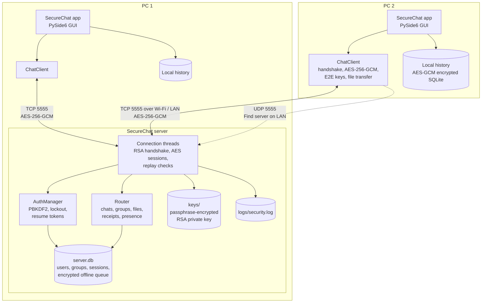

*Figure 6.1 — Components of SecureChat. The server can run on either PC; any number of clients may connect.*

The system follows a **client–server** model with a **thread-per-connection** server. Each client owns one
TCP connection and one session key; the server decrypts each incoming packet with the sender's key and
re-encrypts it with each recipient's key (hop-by-hop), unless the message is end-to-end encrypted.

### 6.2 Handshake (key establishment)

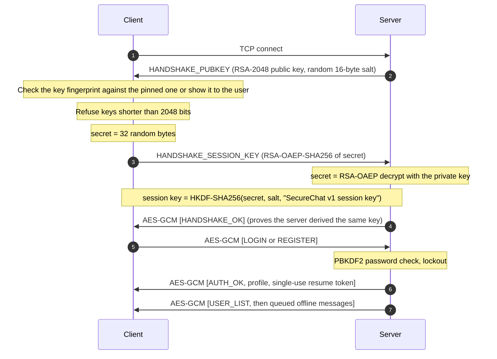

*Figure 6.2 — Handshake and login. Only steps 2 and 4 are unencrypted, and they contain nothing secret:
a public key, a salt and an RSA ciphertext.*

The client contributes the secret and the server contributes the salt, so the session key is fresh even if
one side's randomness were weak; a recorded session replayed to the server meets a new salt and fails.

### 6.3 Packet format

```
 ┌──────────────┬────────────────┬──────────────────────────────┬───────────────────┐
 │ length (4 B) │  nonce (12 B)  │   ciphertext (variable)      │   GCM tag (16 B)  │
 │ big-endian   │  random        │   AES-256-GCM(JSON payload)  │                   │
 └──────────────┴────────────────┴──────────────────────────────┴───────────────────┘
  JSON payload: {"type": "CHAT_MSG", "seq": 7, "ts": 1763490000.12, "id": "...", "to": "bob", "text": "..."}
  Associated data (authenticated, not sent): "SecureChat/1|C2S" or "SecureChat/1|S2C"
```

*Figure 6.3 — Every packet after the handshake. Even the message type is inside the ciphertext, so an
eavesdropper cannot tell a chat message from a typing notification. Overhead: 4 + 12 + 16 = 32 bytes.*

### 6.4 Message flow

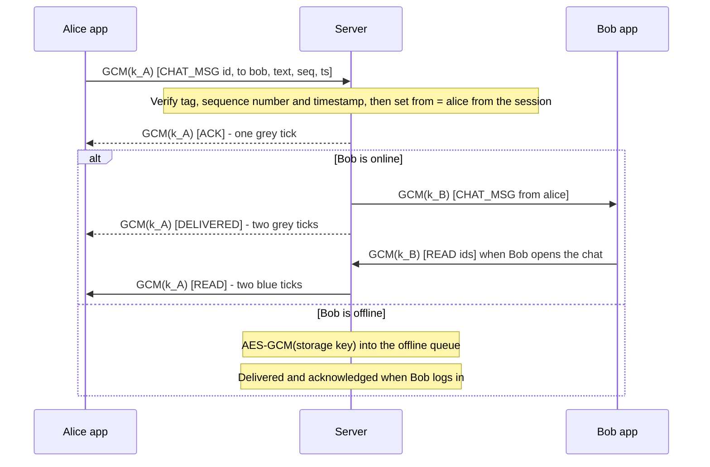

*Figure 6.4 — A one-to-one message. `k_A` and `k_B` are the two users' separate session keys. In
end-to-end mode the `text` field is replaced by a sealed blob that the server cannot decrypt.*

### 6.5 End-to-end encryption

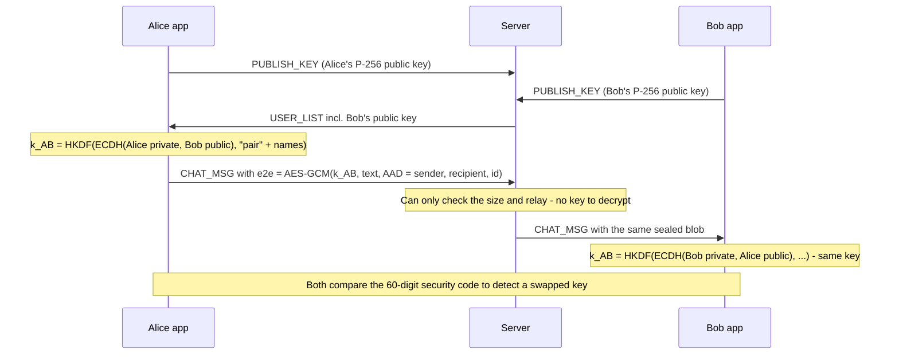

*Figure 6.5 — End-to-end mode. The private identity keys never leave the users' PCs.*

### 6.6 Data flow diagram — level 0 (context)

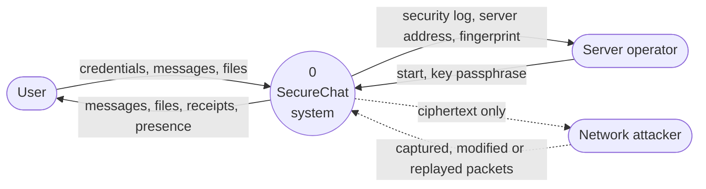

*Figure 6.6 — Context diagram.*

### 6.7 Data flow diagram — level 1

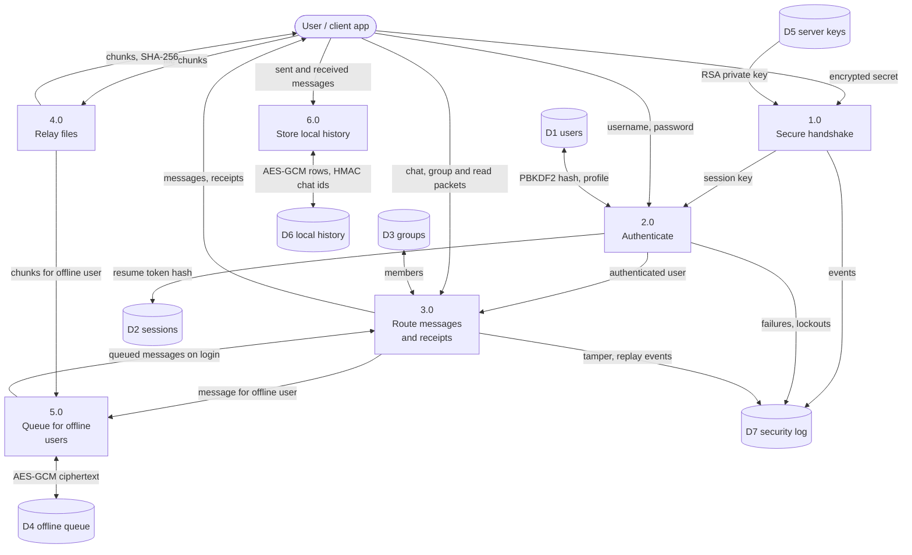

*Figure 6.7 — Level-1 DFD. Processes 1–5 run on the server, process 6 on each client.*

### 6.8 Use case diagram

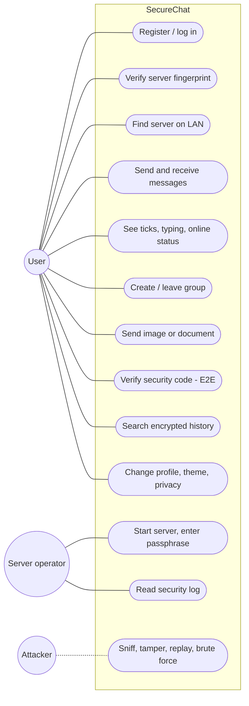

*Figure 6.8 — Use cases. The attacker's actions are all blocked (section 9).*

## 7. Module Description

| Package | Module | Responsibility |
|---|---|---|
| `common` | `crypto_utils.py` | AES-256-GCM encrypt/decrypt, RSA-2048-OAEP, HKDF session keys, PBKDF2 password hashing, key fingerprints; CBC/CTR/ECB only for benchmarks |
| | `protocol.py` | Length-prefixed framing, message types, `SecureChannel` (encrypt, decrypt, sequence and timestamp checks), client and server handshakes |
| | `e2e.py` | P-256 identity keys, ECDH pairwise keys, sealing/opening E2E messages, 60-digit security code |
| | `discovery.py` | UDP broadcast "Find server on LAN" (server responder and client search, no-amplification rule) |
| | `config.py` | Settings from `config.json` with command-line overrides |
| `server` | `server.py` | Thread-per-client server: handshake, authentication, routing of chats, groups, files, receipts, presence; offline queue; violation counting |
| | `auth.py` | Registration and login rules, PBKDF2 verification, lockout, resume tokens |
| | `database.py` | SQLite: users, groups, members, sessions, encrypted offline messages (thread-safe, parameterised queries) |
| | `security_log.py` | Colour console and rotating `security.log` of security events (never plaintext or keys) |
| `client` | `network.py` | `ChatClient`: connect + handshake with fingerprint pinning, events, heartbeat, reconnect with resume token, E2E sealing, chunked file transfer with SHA-256 verification |
| | `local_store.py` | Encrypted per-user history: PBKDF2 key, HKDF sub-keys, AES-GCM rows, HMAC chat index |
| | `files.py` | File-name sanitising (path traversal, Unicode tricks, device names), sizes, MIME types |
| | `cli_client.py` | Terminal client used before the GUI existed |
| `client/gui` | `main.py`, `login_window.py`, `main_window.py` | Application controller, login/register screen with fingerprint dialog and LAN search, main window |
| | `chat_store.py` | GUI data model: chats, messages, ticks, pending/resend, history persistence |
| | `bridge.py`, `workers.py`, `reconnect.py` | Thread-safe signals from the network thread, worker threads, automatic reconnection |
| | `widgets/` | Chat list, chat view, bubbles, file bubbles, input bar, emoji picker, group dialogs, settings, security code, message info |
| `security_demo` | `sniffer_proxy.py`, `tamper_test.py`, `replay_test.py`, `bruteforce_login_test.py`, `insecure_chat.py`, `run_all.py` | Attack demonstrations and a deliberately insecure chat for comparison |
| `performance` | `benchmark_crypto.py`, `benchmark_network.py`, `make_report.py` | Benchmarks, graphs and the generated performance report |
| `tests` | 23 files | 287 automated tests (section 12) |

In total the application (`common`, `server`, `client`) is about 10,700 lines of Python, with a further
3,700 lines of tests.

## 8. Implementation Details

### 8.1 AES-256-GCM encryption with a fresh nonce

`common/crypto_utils.py`

```python
def aes_encrypt(key: bytes, plaintext: Union[str, bytes],
                associated_data: Optional[bytes] = None) -> bytes:
    _check_aes_key(key)
    nonce = get_random_bytes(GCM_NONCE_SIZE)                       # 12 fresh random bytes every time
    cipher = AES.new(key, AES.MODE_GCM, nonce=nonce, mac_len=GCM_TAG_SIZE)
    if associated_data:
        cipher.update(associated_data)                            # authenticated, not encrypted
    ciphertext, tag = cipher.encrypt_and_digest(_to_bytes(plaintext))
    return nonce + ciphertext + tag


def aes_decrypt(key: bytes, blob: bytes, associated_data: Optional[bytes] = None) -> bytes:
    ...
    try:
        return cipher.decrypt_and_verify(ciphertext, tag)         # constant-time tag check
    except ValueError as exc:
        raise IntegrityError("GCM authentication failed - message tampered or wrong key") from exc
```

The nonce comes from the operating system's CSPRNG. With random 96-bit nonces the probability of a repeat
within one session key's lifetime is negligible, and every connection uses a new key.

### 8.2 The secure channel: integrity, direction and replay checks

`common/protocol.py` — every received packet passes four checks before it is used:

```python
def recv(self) -> dict:
    with self._recv_lock:
        frame = recv_frame(self.sock, self.max_frame_size)          # size checked before reading
        plaintext = cu.aes_decrypt(self._key, frame, self._recv_aad)  # 1+2: tag and direction
        message = json.loads(plaintext.decode("utf-8"))
        ...
        seq, ts = message.get("seq"), message.get("ts")
        if seq <= self._recv_seq:                                    # 3: replay
            raise ReplayError(f"Replayed message: seq {seq} <= last seen {self._recv_seq}")
        if abs(self._clock() - ts) > self.max_clock_skew:            # 4: stale or delayed
            raise ReplayError(f"Stale message: timestamp is {self._clock() - ts:+.0f}s off")
        self._recv_seq = seq
        return message
```

The associated data differs per direction (`SecureChat/1|C2S` vs `|S2C`), so a packet the server sent cannot
be reflected back to it. Sending takes a lock around "next sequence number + write", so concurrent threads
never put packets on the wire out of order.

### 8.3 Server authentication in the handshake

```python
fingerprint = cu.public_key_fingerprint(server_key)
if expected_fingerprint and _normalise_fp(expected_fingerprint) != _normalise_fp(fingerprint):
    raise HandshakeError("Server key fingerprint does not match - possible man-in-the-middle!")
...
secret = cu.generate_aes_key(SECRET_SIZE)
_send_json(sock, {"type": MsgType.HANDSHAKE_SESSION_KEY.value,
                  "encrypted_secret": b64e(cu.rsa_encrypt(server_key, secret))})
channel = SecureChannel(sock, cu.derive_session_key(secret, salt), "client", **channel_kwargs)
```

On first contact the GUI shows the fingerprint for the user to compare with the server window
(trust-on-first-use); afterwards it is pinned, and a changed key triggers a red warning.

### 8.4 Password storage

```python
def hash_password(password: str, iterations: int = PBKDF2_ITERATIONS) -> str:
    salt = get_random_bytes(SALT_SIZE)                              # 16 random bytes per user
    digest = PBKDF2(_password_bytes(password), salt, dkLen=32, count=iterations,
                    hmac_hash_module=SHA256)
    return "$".join([_PASSWORD_SCHEME, str(iterations),
                     base64.b64encode(salt).decode(), base64.b64encode(digest).decode()])
```

Verification uses `hmac.compare_digest` (constant time). Unknown usernames are checked against a dummy hash,
so neither the error message nor the response time reveals which accounts exist; five wrong passwords lock an
account for 60 seconds.

### 8.5 The sender cannot be forged

`server/server.py` — the `from` field is never taken from the client:

```python
# "from" is set by the server from the authenticated session, so it can't be spoofed
forward = {"type": MsgType.CHAT_MSG, "id": msg_id, "from": session.username,
           "to": recipient, "sent_at": message["ts"]}
```

### 8.6 End-to-end sealing

`common/e2e.py`

```python
def pair_key(my_key, my_name, their_key, their_name) -> bytes:
    names = "|".join(sorted([my_name, their_name])).encode("utf-8")
    kdf = lambda shared: HKDF(shared, 32, HKDF_SALT, SHA256, context=b"pair|" + names)
    return key_agreement(static_priv=my_key, static_pub=their_key, kdf=kdf)


def seal(key, sender, recipient, msg_id, text) -> str:
    blob = cu.aes_encrypt(key, text.encode("utf-8"), _aad(sender, recipient, msg_id))
    return base64.b64encode(blob).decode("ascii")
```

The associated data binds each sealed message to its sender, recipient and message id, so the server can
neither re-address nor re-label it without the tag check failing.

### 8.7 File transfer integrity

Files are sent as `FILE_START` (name, size, chunk count, SHA-256), up to 400 `FILE_CHUNK` packets of 64 KB
(each its own AES-GCM packet) and `FILE_END`. The receiver writes to a `.part` file and only keeps it if
every chunk arrived in order and the hash matches:

```python
if not error and not hmac.compare_digest(state["sha256"].hexdigest(), meta["sha256"]):
    error = "SHA-256 check failed - the file was corrupted or tampered with"
if error:
    state["part"].unlink(missing_ok=True)
```

File names from the network are sanitised against path traversal (`..\..\`), invisible right-to-left
characters (`photo‮gpj.exe` displayed as `photoexe.jpg`) and Windows device names (`CON`, `NUL`).

### 8.8 Encrypted local history

The history key is derived from the user's password with PBKDF2 and never stored. HKDF splits it into three
independent sub-keys — encryption, indexing and password verification. Each row is AES-GCM encrypted with
its message id as associated data (rows cannot be swapped), and chats are indexed by
`HMAC-SHA256(index key, chat id)`, so the file does not even reveal *who* the user talks to.

### 8.9 Keeping the GUI responsive

Connecting, logging in, reconnecting and file uploads run in `QThread` workers; the network receiver thread
hands events to the GUI through Qt signals (`ClientBridge`). Small sends from the GUI thread are bounded by a
10-second socket send timeout; if a send fails, the connection is closed and the client reconnects
automatically (1, 2, 4, 8, then every 15 s) using a single-use resume token, then resends pending messages.

## 9. Security Analysis

### 9.1 Threat model

* **Attacker capabilities:** full control of the network between client and server (Dolev–Yao): can read,
  drop, modify, inject and replay packets; can run their own server; may steal the server's database or a
  user's laptop; may try passwords online.
* **Trusted:** the endpoints' operating systems and PyCryptodome; the server *operator* is trusted for
  hop-by-hop chats but not in E2E mode.
* **Out of scope:** malware on an endpoint, denial-of-service by flooding the network, physical coercion.

### 9.2 Threats and countermeasures

| Threat | Attack | How SecureChat handles it | Evidence |
|---|---|---|---|
| **Eavesdropping** | Capture packets with Wireshark or a proxy | All traffic after the handshake is AES-256-GCM; message types are inside the ciphertext; handshake reveals only a public key, salt and RSA ciphertext | `sniffer_proxy.py`, `run_all.py` eavesdropping demo, `docs/WIRESHARK_GUIDE.md` |
| **Man-in-the-middle** | Attacker runs a proxy presenting its own RSA key | Server key fingerprint compared by the user, then pinned; mismatch aborts before any secret is sent; key confirmation (HANDSHAKE_OK); weak keys (< 2048 bits) refused | `test_protocol.py`, `test_presence.py` (new server key refused on reconnect) |
| **Tampering** | Flip bits in a packet | GCM tag check fails → packet dropped, logged as TAMPER; 3 violations close the connection; files additionally SHA-256 verified | `tamper_test.py`, `test_server.py`, `test_files.py` |
| **Replay** | Re-send a captured packet in the same or a later session | Strictly increasing sequence numbers; timestamps within ±60 s; new HKDF salt per session makes old packets undecryptable; direction-bound AAD stops reflection | `replay_test.py`, `test_protocol.py` |
| **Brute force (online)** | Guess passwords through the login | PBKDF2 per attempt; lockout after 5 failures for 60 s; identical errors and timing for unknown users | `bruteforce_login_test.py`, `test_auth.py` |
| **Brute force (offline)** | Steal `server.db` and crack hashes | Salted PBKDF2-HMAC-SHA256 with 200,000 rounds: 74 guesses/s per CPU core | Section 10, `test_server.py` |
| **Stolen server database** | Read offline messages, tokens | Offline messages AES-GCM encrypted with a storage key that is itself RSA-encrypted; resume tokens stored only as SHA-256 hashes; RSA private key file passphrase-encrypted | `test_server.py` |
| **Compromised / curious server** | Server reads or alters messages | E2E mode: server relays ECDH-sealed ciphertext it cannot decrypt or forge; the security code exposes a substituted key | `test_e2e.py`, `--show-bodies` demo |
| **Stolen laptop** | Read local chat history | History encrypted under a PBKDF2 key from the user's password; chat partners hidden behind HMAC | `test_history.py`, Settings → Security → *Show what's stored on disk* |
| **Malicious peer** | Path traversal, extension spoofing, oversized or malformed packets | File-name sanitising; frame size limits (8 KB in handshake, 1 MB after); field validation with error codes; offline queue cap | `test_hardening.py`, `test_server_validation.py` |
| **Session hijacking** | Reuse a reconnect token | Tokens are 256-bit, single-use, bound to the user, 24-hour expiry, revoked at logout | `test_auth.py`, `test_presence.py` |

### 9.3 Residual risks

* **No forward secrecy.** If the server's RSA private key (and its passphrase) were stolen, recorded past
  sessions could be decrypted, because the session secret is RSA-encrypted rather than agreed with ephemeral
  Diffie–Hellman. E2E keys are also static.
* **Group messages and files are not end-to-end encrypted**; the server can read them.
* **Metadata** (who talks to whom, when, message sizes) is visible to the server.
* **Trust on first use:** a user who accepts the first fingerprint without comparing it can be fooled once.
* **Lockout can be abused** to lock someone else's account for 60 seconds.

## 10. Performance Evaluation

The full method, tables and graphs are in `performance/PERFORMANCE_REPORT.md`, generated from the measured
CSV files. All numbers below come from one laptop (Intel Core i5-13500H, Windows 11, Python 3.13,
PyCryptodome 4.5.0).

| Measurement | Result |
|---|---|
| AES-256-GCM, 1 MB messages | 1,015 MB/s encrypt, 1,337 MB/s decrypt |
| AES-256-GCM, one 1 KB message | 44 µs (CBC + HMAC: 24 µs; CTR: 11 µs; ECB: 7 µs) |
| Key size at 1 MB (GCM) | AES-128 1,027 · AES-192 1,037 · AES-256 1,015 MB/s (within 1 %) |
| Ciphertext overhead per message | GCM 28 B · CBC + HMAC 64 B · CTR 8 B · ECB 16 B |
| Complete handshake | 2.1 ms (RSA-OAEP decrypt 0.62 ms; encrypt 0.067 ms; HKDF 0.027 ms) |
| RSA-2048 key generation | 213 ms, once on the server's first start |
| PBKDF2, 200,000 rounds | 13.5 ms per login → 74 password guesses per second per core |
| Round trip of a 1 KB message (one PC) | 0.69 ms SecureChat vs 0.03 ms plaintext (+0.66 ms) |
| Messages per second, one server process | ≈ 1,300–1,470 (latency grows ≈ 0.76 ms per extra active client) |
| 25 MB file, sent and received back | 0.58 s (43 MB/s) vs 0.31 s plaintext |

**Discussion.** GCM is slower than CBC + HMAC for tiny messages in PyCryptodome because of a fixed
per-message set-up cost, but it is 2.6× faster at 1 MB, has less overhead, needs no padding and provides
integrity in one primitive — and the 20 µs difference is invisible next to a network round trip. The extra
0.66 ms per message is about 150 times below the ~100 ms threshold at which users perceive delay. The RSA
handshake costs about as much as three message round trips, paid once per connection. The server's
throughput is limited by Python's global interpreter lock rather than by cryptography; it still has about 50×
headroom for 50 very active users.

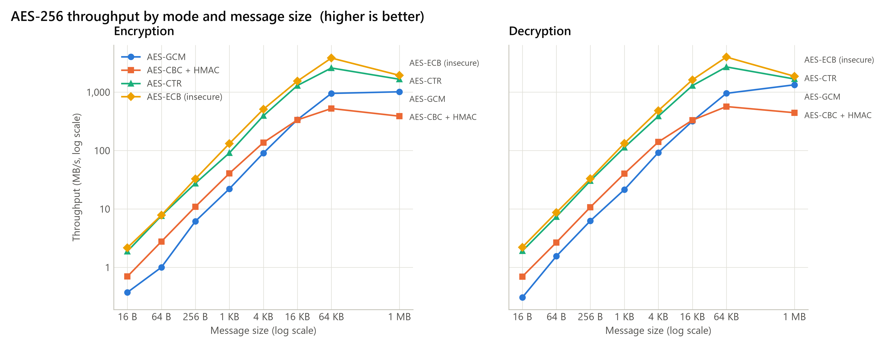

*Figure 10.1 — AES-256 throughput by mode and message size (log scales).*

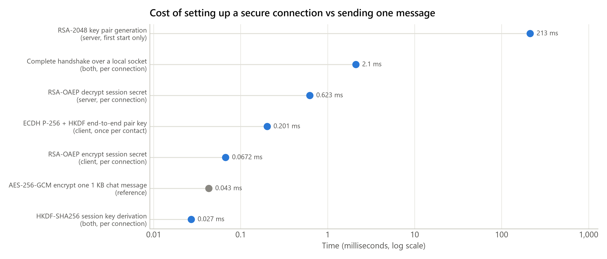

*Figure 10.2 — The one-off handshake costs compared with encrypting one message.*

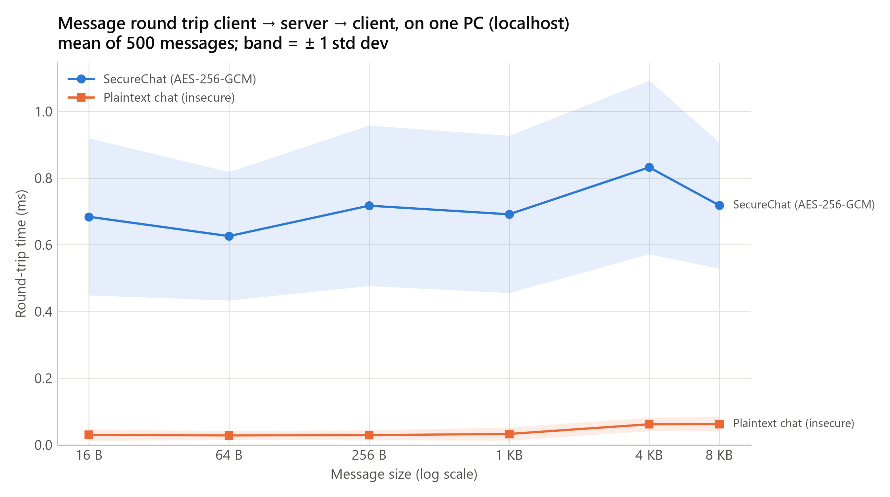

*Figure 10.3 — Round trip client → server → client, SecureChat vs plaintext.*

> The two-PC (Wi-Fi) measurement is produced by `python -m performance.benchmark_network --remote <ip>`;
> regenerate the performance report afterwards to include it.

## 11. Screenshots

> Save each screenshot under `docs/screenshots/` with the file name shown; it then appears here
> automatically. (Windows: **Win + Shift + S** to capture a window.)

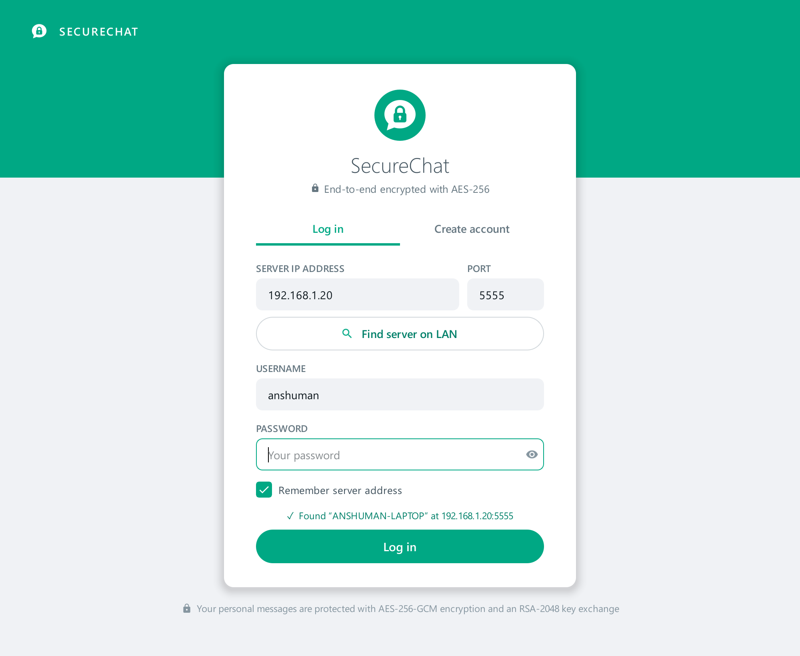

*Figure 11.1 — Login screen with "Find server on LAN". (Capture: `run_client.bat`, before logging in.)*

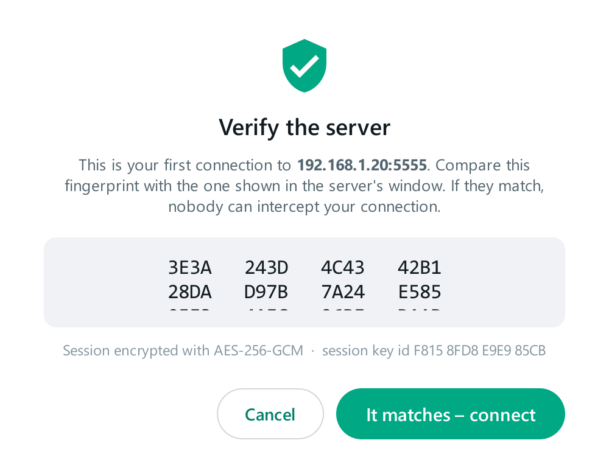

*Figure 11.2 — First connection: verifying the server's key fingerprint against the server window.*

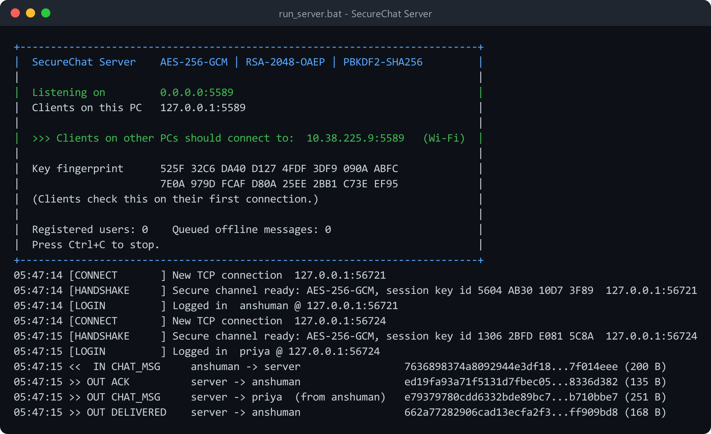

*Figure 11.3 — Server window: LAN address, key fingerprint and live encrypted traffic.*

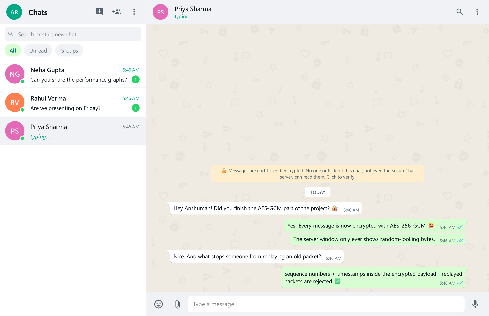

*Figure 11.4 — Main window: chat list, conversation, ticks and typing indicator (light theme).*

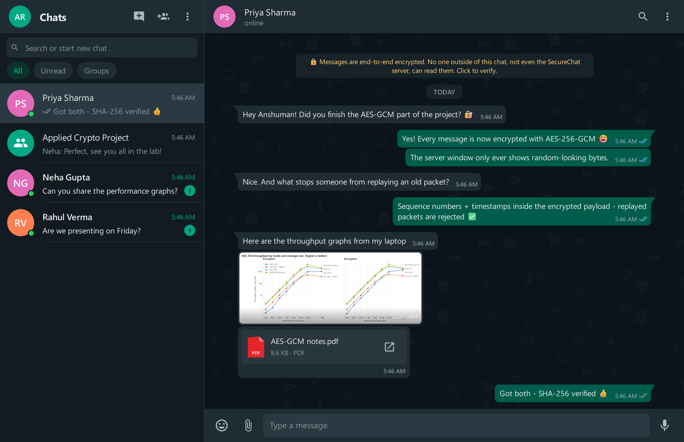

*Figure 11.5 — The same conversation in dark mode.*

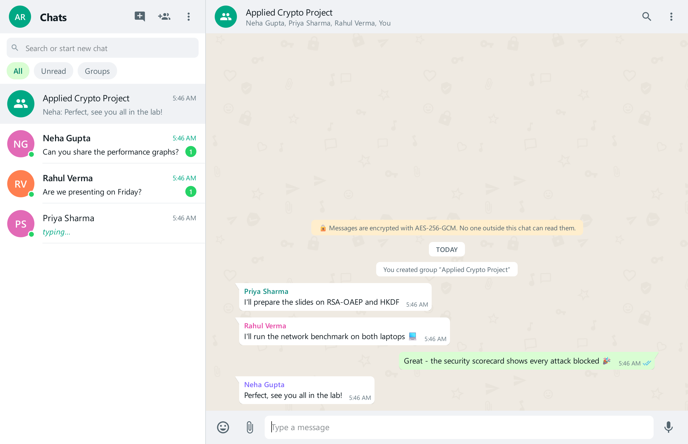

*Figure 11.6 — A group chat with blue ticks once every member has read the message.*

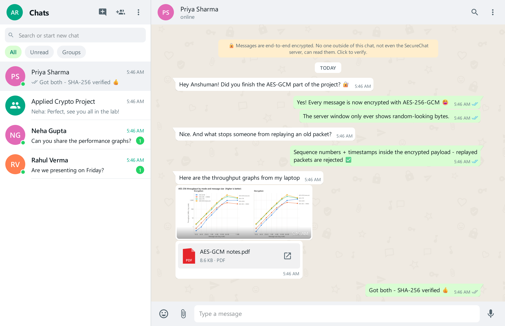

*Figure 11.7 — An image and a PDF received and verified with SHA-256.*

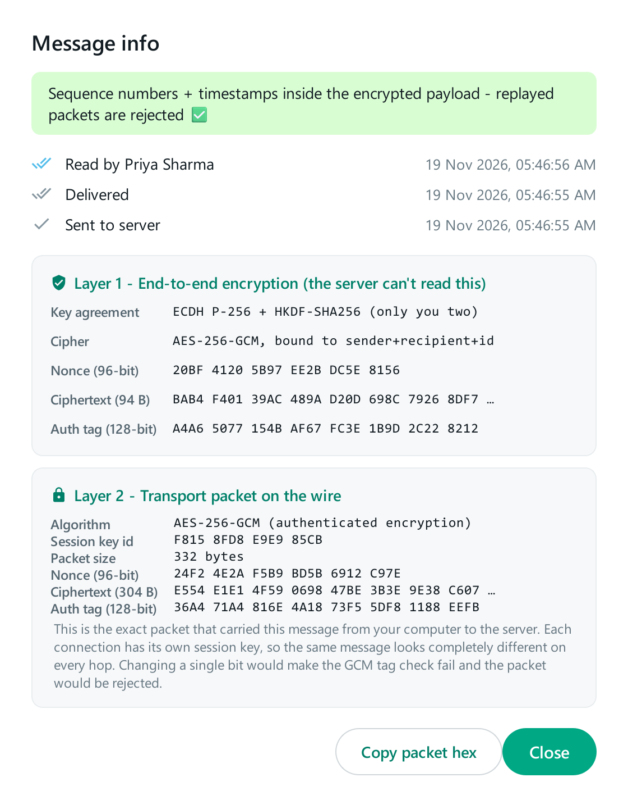

*Figure 11.8 — "Message info": delivery times and the actual encrypted packet that carried the message.*

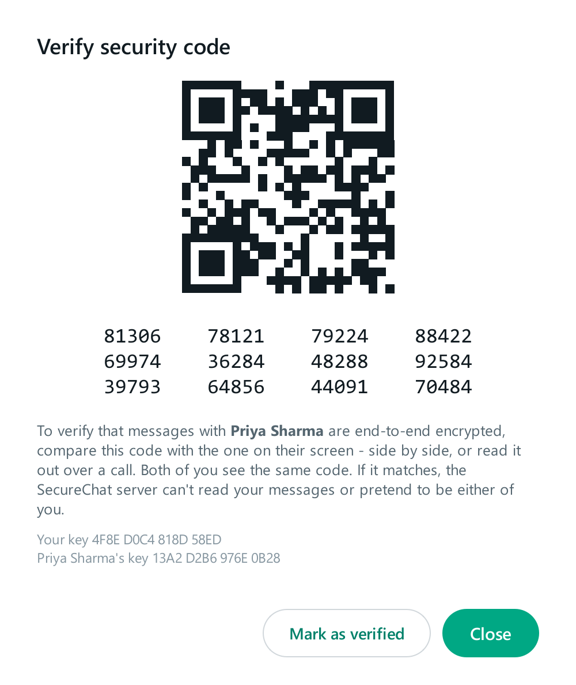

*Figure 11.9 — End-to-end encryption: the 60-digit security code and pattern.*

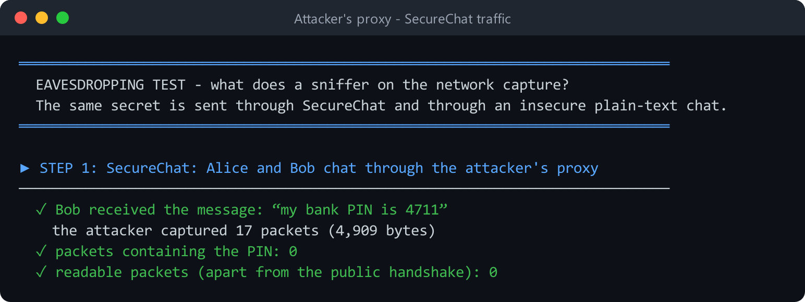

*Figure 11.10 — The attacker's proxy: SecureChat traffic is unreadable random bytes.*

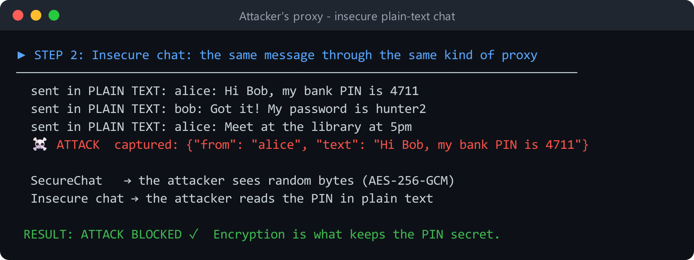

*Figure 11.11 — The same proxy on the insecure chat: every message readable.*

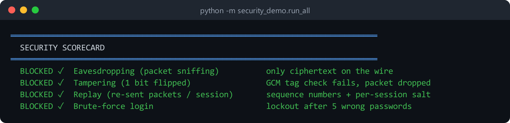

*Figure 11.12 — `python -m security_demo.run_all`: every attack blocked.*


*Figure 11.13 — Wireshark capture of SecureChat traffic (see `docs/WIRESHARK_GUIDE.md`).*

## 12. Testing

### 12.1 Strategy

Testing used **pytest** at three levels: unit tests of the cryptographic and protocol functions,
integration tests against a real server on a random port (with real sockets, threads and SQLite), and GUI
tests that drive the PySide6 windows in Qt's off-screen mode. Security properties are tested by acting as
an attacker: flipping bits, replaying packets, forging senders, sending malformed requests and oversized
frames.

### 12.2 Test suites

| Area | Files | What is checked |
|---|---|---|
| Cryptography | `test_crypto.py` | AES-GCM round trips, tamper and wrong-key detection, nonce uniqueness, RSA-OAEP, fingerprints, PBKDF2, benchmark modes |
| Protocol | `test_protocol.py`, `test_hardening.py` | Framing, oversized frames, handshake, fingerprint pinning, replay, stale timestamps, reflection, weak server keys |
| Server and auth | `test_server.py`, `test_auth.py`, `test_server_validation.py` | Registration rules, hashing, no username enumeration, lockout and its expiry, resume tokens, sender spoofing, offline queue, 39 malformed requests |
| Messaging | `test_integration.py`, `test_presence.py`, `test_groups.py` | Chat, receipts, typing, presence, heartbeat, reconnect after a drop or server restart, group fan-out and aggregated ticks |
| Files | `test_files.py`, `test_hardening.py` | Identical transfer, SHA-256 rejection of tampered files, path traversal, Unicode tricks, aborted transfers |
| End-to-end and history | `test_e2e.py`, `test_history.py` | Server (even with all its keys) cannot read E2E messages, security codes detect a swapped key, no plaintext in the history file, wrong password refused, tampered or swapped rows skipped |
| GUI | `test_gui_login.py`, `test_main_window.py`, `test_chat_view.py`, `test_discovery.py` | Login flow, fingerprint dialog, chat view, LAN discovery |
| Demos and tools | `test_security_demos.py`, `test_benchmark*.py`, `test_make_report.py`, `test_config.py` | Every attack demo reports "blocked"; benchmarks and report generator work |

### 12.3 Results

* **287 tests pass** (about one minute on the test laptop).
* **Statement coverage:** 92 % of `common/` and `server/`, 85 % of the application code including the GUI
  (`common/`, `server/`, `client/`; measured with `coverage.py`).
* **Static analysis:** `ruff` reports no unused imports, undefined names or swallowed exception chains.
* **Security demo scorecard** (`python -m security_demo.run_all`): eavesdropping, tampering, replay and brute
  force — all **BLOCKED**.
* **Code review** (Prompt 19) found and fixed, among others: a crash for passwords outside Latin-1, file-name
  extension spoofing with Unicode right-to-left characters, file transfers left hanging when a sender
  disconnected, an unbounded failed-login table and offline queue, and a possible GUI freeze on a dead
  network. Each has a regression test.

## 13. Limitations

1. **No forward secrecy** — RSA key transport and static E2E keys (section 9.3).
2. **End-to-end mode covers one-to-one text only**; group messages and files are protected hop-by-hop.
3. **Scalability** — one Python process with a thread per client; the global interpreter lock caps the
   server at roughly 1,300–1,500 messages per second.
4. **PBKDF2 at 200,000 rounds** is below the current OWASP recommendation (600,000) and is not memory-hard.
5. **Clock dependence** — replay protection rejects packets more than 60 s old, so the two PCs' clocks must
   be roughly in sync.
6. **Metadata** is visible to the server.
7. **Single server, no federation or mobile clients**; tested on Windows only.
8. **Performance figures** come from one laptop and, so far, from one PC (localhost).

## 14. Future Scope

1. **Forward secrecy:** replace RSA key transport with ephemeral ECDH (X25519) signed by the server's
   long-term key, as in TLS 1.3; adopt X3DH + Double Ratchet for end-to-end messages.
2. **End-to-end groups and files** using Sender Keys (as in WhatsApp).
3. **Stronger password hashing:** Argon2id, or at least 600,000 PBKDF2 rounds.
4. **Scalable server:** `asyncio` with several worker processes, or a compiled language.
5. **Certificate-based server authentication** (a small private CA) instead of trust-on-first-use.
6. **Disappearing messages, message deletion for everyone, voice notes, mobile client.**
7. **Formal verification** of the handshake with a protocol analyser such as ProVerif or Tamarin.

## 15. Conclusion

SecureChat meets all its objectives. Two or more PCs can chat through a WhatsApp-style interface while every
packet on the network is encrypted and authenticated with AES-256-GCM under a fresh per-connection key
established with RSA-2048-OAEP and HKDF. Replayed, modified and forged packets are rejected; passwords are
stored as salted PBKDF2 hashes behind a lockout; and an optional end-to-end mode with a verifiable security
code keeps even the server from reading one-to-one conversations. The built-in attack demonstrations show
each protection working, and 287 automated tests guard the implementation.

The performance evaluation shows that this protection is effectively free for users: the full secure
protocol adds well under a millisecond per message, the handshake is paid once per session, and AES-256 is
as fast as AES-128 on modern hardware. The main lessons are that authenticated encryption — not encryption
alone — is what protects a messaging protocol, that nonce and key management matter as much as the cipher,
and that the remaining gaps (forward secrecy, end-to-end groups) are exactly the problems the Signal
Protocol's more complex machinery was designed to solve.

## 16. References

1. NIST, *FIPS 197: Advanced Encryption Standard (AES)*, 2001 (updated 2023).
2. M. Dworkin, *NIST SP 800-38D: Recommendation for Block Cipher Modes of Operation: Galois/Counter Mode
   (GCM) and GMAC*, NIST, 2007.
3. K. Moriarty, B. Kaliski, J. Jonsson, A. Rusch, *RFC 8017: PKCS #1: RSA Cryptography Specifications
   Version 2.2*, IETF, 2016.
4. M. Bellare, P. Rogaway, "Optimal Asymmetric Encryption," *EUROCRYPT '94*, LNCS 950, Springer, 1995.
5. K. Moriarty, B. Kaliski, A. Rusch, *RFC 8018: PKCS #5: Password-Based Cryptography Specification Version
   2.1*, IETF, 2017.
6. H. Krawczyk, P. Eronen, *RFC 5869: HMAC-based Extract-and-Expand Key Derivation Function (HKDF)*, IETF,
   2010.
7. H. Krawczyk, "Cryptographic Extraction and Key Derivation: The HKDF Scheme," *CRYPTO 2010*, LNCS 6223,
   Springer, 2010.
8. E. Barker, *NIST SP 800-57 Part 1 Rev. 5: Recommendation for Key Management*, NIST, 2020.
9. E. Rescorla, *RFC 8446: The Transport Layer Security (TLS) Protocol Version 1.3*, IETF, 2018.
10. D. Bleichenbacher, "Chosen Ciphertext Attacks Against Protocols Based on the RSA Encryption Standard
    PKCS #1," *CRYPTO '98*, LNCS 1462, Springer, 1998.
11. S. Vaudenay, "Security Flaws Induced by CBC Padding — Applications to SSL, IPSEC, WTLS…,"
    *EUROCRYPT 2002*, LNCS 2332, Springer, 2002.
12. N. Ferguson, B. Schneier, T. Kohno, *Cryptography Engineering*, Wiley, 2010.
13. A. Joux, "Authentication Failures in NIST Version of GCM," comments submitted to NIST, 2006.
14. H. Böck, A. Zauner, S. Devlin, J. Somorovsky, P. Jovanovic, "Nonce-Disrespecting Adversaries: Practical
    Forgery Attacks on GCM in TLS," *USENIX WOOT '16*, 2016.
15. W. Stallings, *Cryptography and Network Security: Principles and Practice*, 8th ed., Pearson, 2020.
16. M. S. Turan, E. Barker, W. Burr, L. Chen, *NIST SP 800-132: Recommendation for Password-Based Key
    Derivation*, NIST, 2010.
17. OWASP Foundation, *Password Storage Cheat Sheet*, https://cheatsheetseries.owasp.org/.
18. WhatsApp, *WhatsApp Encryption Overview* (technical white paper), https://www.whatsapp.com/security/.
19. M. Marlinspike, T. Perrin, *The X3DH Key Agreement Protocol*, Signal, 2016.
20. T. Perrin, M. Marlinspike, *The Double Ratchet Algorithm*, Signal, 2016.
21. K. Cohn-Gordon, C. Cremers, B. Dowling, L. Garratt, D. Stebila, "A Formal Security Analysis of the
    Signal Messaging Protocol," *IEEE EuroS&P 2017*.
22. J. Nielsen, *Usability Engineering*, Academic Press, 1993 (response-time limits).
23. PyCryptodome documentation, https://www.pycryptodome.org/.
24. Qt for Python (PySide6) documentation, https://doc.qt.io/qtforpython-6/.

---

## Appendix A — How to Run

```
run_server.bat                     (PC 1 - first run asks for a key passphrase)
run_client.bat                     (any PC - "Find server on LAN", or type the IP the server shows)

python -m pytest                   (287 tests)
python -m security_demo.run_all    (attack scorecard)
python -m performance.benchmark_crypto
python -m performance.benchmark_network [--remote <server-ip>]
python -m performance.make_report
```

Two-PC set-up, firewall rules and troubleshooting: `docs/DEPLOYMENT.md`.
