# SecureChat - Performance Report

*Generated 2026-11-19 03:36 by `python -m performance.make_report` from the files in `performance/results/`. Every measured number below comes from those files; derived figures (ratios, estimates) are calculated from them.*

## 1. Objective

Measure what SecureChat's security costs in speed and resources, and decide whether that cost is acceptable:

* compare AES modes (GCM, CBC + HMAC, CTR, ECB) and key sizes (128/192/256-bit) on realistic message sizes;
* measure the one-off costs: the RSA-2048 handshake per connection and PBKDF2 password hashing per login;
* measure the end-to-end overhead of the full secure protocol against an identical chat with no security, including throughput, file transfer and behaviour with up to 50 simultaneous clients;
* judge whether any of this is noticeable to users.

## 2. Test environment

Recorded automatically by `performance/environment.py` every time a benchmark runs (saved to `performance/results/environment.json` and `network_*_environment.json`).

| Item | Value |
| --- | --- |
| CPU | 13th Gen Intel(R) Core(TM) i5-13500H |
| Cores | 12 physical / 16 logical |
| RAM | 15.7 GB |
| Operating system | Windows-11-10.0.26200-SP0 |
| Python | 3.13.0 |
| PyCryptodome | 4.5.0 |
| matplotlib / PySide6 | 3.11.2 / 6.12.0 |
| Crypto benchmark run | 2026-11-19 00:16 |

**Network benchmark, one PC (localhost):** run 2026-11-19 00:30 on the same machine.

## 3. Methodology

### 3.1 Cryptographic benchmark (`performance/benchmark_crypto.py`)

* **What one operation is.** One call is one complete per-message operation, exactly as the chat performs it: a new cipher object, a fresh random nonce/IV and, for CBC, the HMAC. The functions timed are the ones in `common/crypto_utils.py` that the application uses.
* **Matrix.** 4 modes (GCM, CBC + HMAC-SHA256, CTR, ECB) × 3 key sizes (128/192/256-bit) × 8 message sizes (16 B … 1 MB).
* **Timing.** `time.perf_counter()` around every single call, 1,000 timed calls per measurement after untimed warm-up calls (50 in a full run); reported as **mean ± standard deviation**. Throughput = message size ÷ mean time, with 1 MB = 1,048,576 bytes.
* **Correctness first.** Before timing, every mode's ciphertext is decrypted and compared with the original, so only working round trips are measured.
* **Fair key-size comparison.** For each mode and size, the three key sizes are measured back to back, so slow changes in the laptop CPU's turbo clock affect all three equally.
* **CPU and memory.** `psutil`: process CPU time ÷ wall time (100 % = one core fully busy) and resident memory (RSS) sampled every 10 ms while encrypting 1 MB messages non-stop for 3 s per mode.
* **Handshake and PBKDF2.** The real `server_handshake`/`client_handshake` over a local socket pair (200 runs); PBKDF2-HMAC-SHA256 for 1,000 … 1,000,000 rounds (5-50 runs each).

### 3.2 Network benchmark (`performance/benchmark_network.py`)

* **The two systems.** *SecureChat* = the real `ChatServer` and `ChatClient` (RSA-2048 handshake, AES-256-GCM on every packet, sequence numbers, timestamps, receipts). *Plaintext* = the deliberately insecure demo chat (`security_demo/insecure_chat.py`): the same TCP, the same JSON and the same base64 file chunks, but no encryption, no authentication and no checks.
* **One clock.** Every simulated user sends messages to *itself*, so each sample is a full trip client → server → client timed on one computer, with no need to synchronise two PCs' clocks.
* **Server measured on its own.** The servers run in a separate process; a small stats endpoint reports that process's CPU time and memory, which also works when the server is on another PC.
* **Interleaving.** For each message size SecureChat and plaintext are measured one after the other, so both see the same machine and network conditions.
* **Scalability.** N clients (1-50) chat non-stop for a fixed window. The clients are spread over 8 worker processes, because one Python process runs Python code on only one core at a time - with all clients in one process, the *benchmark* would be the bottleneck instead of the server.

| Network run | Messages per size (latency) | Burst (throughput) | Window per client count | Repeats per file |
| --- | ---: | ---: | ---: | ---: |
| one PC (localhost) | 500 | 2,000 | 3 s | 3 |

## 4. Results

### 4.1 AES modes (AES-256)

Time for one complete encryption / decryption (mean ± std dev) and throughput:

| Mode | Encrypt 16 B | Encrypt 1 KB | Encrypt 64 KB | Encrypt 1 MB | Decrypt 1 MB | Detects tampering |
| --- | ---: | ---: | ---: | ---: | ---: | ---: |
| AES-GCM | 40.8 ± 15.7 µs | 44.1 ± 20.8 µs | 65.5 ± 16.6 µs | 1,015 MB/s | 1,337 MB/s | yes |
| AES-CBC + HMAC | 21.8 ± 4.2 µs | 24.0 ± 8.1 µs | 119.0 ± 16.6 µs | 388 MB/s | 445 MB/s | yes |
| AES-CTR | 8.1 ± 3.1 µs | 10.7 ± 13.2 µs | 24.1 ± 12.1 µs | 1,664 MB/s | 1,681 MB/s | **no** |
| AES-ECB (insecure) | 7.0 ± 2.0 µs | 7.4 ± 2.2 µs | 16.3 ± 10.3 µs | 1,941 MB/s | 1,874 MB/s | **no** |

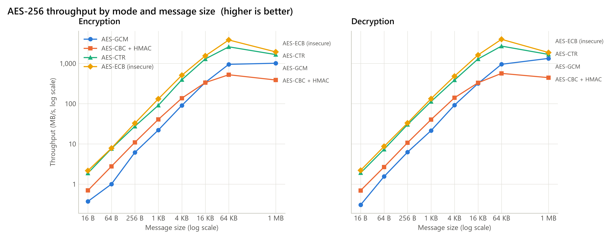

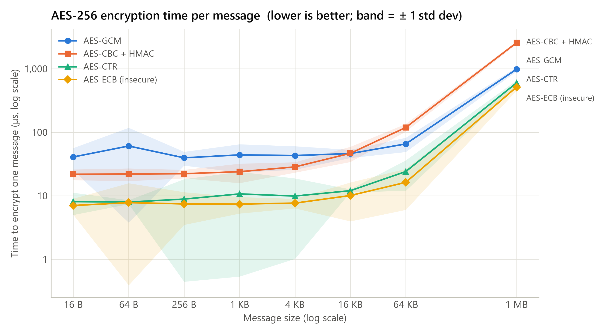

### 4.2 Key sizes (1 MB messages)

| Mode | AES-128 | AES-192 | AES-256 | AES-256 vs AES-128 |
| --- | ---: | ---: | ---: | ---: |
| AES-GCM | 1,027 MB/s | 1,037 MB/s | 1,015 MB/s | -1% |
| AES-CBC + HMAC | 415 MB/s | 401 MB/s | 388 MB/s | -6% |
| AES-CTR | 1,747 MB/s | 1,703 MB/s | 1,664 MB/s | -5% |
| AES-ECB (insecure) | 2,098 MB/s | 1,995 MB/s | 1,941 MB/s | -8% |

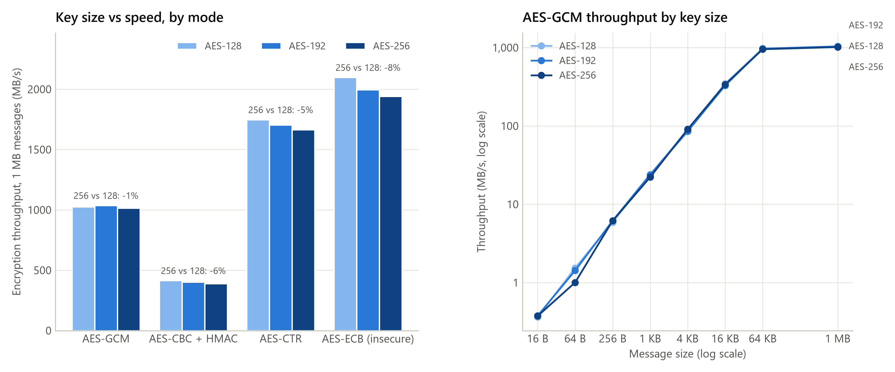

### 4.3 Ciphertext overhead

| Mode | Made of | On a 16 B message | On a 1 KB message |
| --- | --- | ---: | ---: |
| AES-GCM | 12-byte nonce + 16-byte tag | 28 B (175%) | 28 B (2.7%) |
| AES-CBC + HMAC | 16-byte IV + 1-16 bytes padding + 32-byte HMAC | 64 B (400%) | 64 B (6.2%) |
| AES-CTR | 8-byte nonce | 8 B (50%) | 8 B (0.8%) |
| AES-ECB (insecure) | 1-16 bytes padding | 16 B (100%) | 16 B (1.6%) |

(16 B and 1 KB are multiples of the 16-byte block, so PKCS#7 adds a whole extra block for CBC and ECB.)

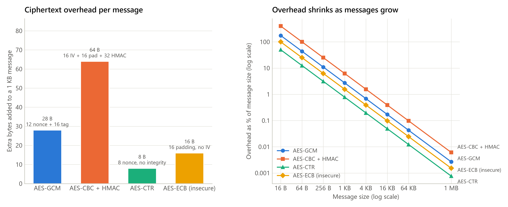

### 4.4 Connection handshake and key agreement

| Operation | Who / how often | Time | Runs |
| --- | --- | ---: | ---: |
| RSA-2048 key pair generation | server, first start only | 212.735 ± 102.262 ms | 10 |
| Complete handshake over a local socket | both, per connection | 2.103 ± 1.174 ms | 200 |
| RSA-OAEP decrypt session secret | server, per connection | 0.623 ± 0.114 ms | 1,000 |
| ECDH P-256 + HKDF end-to-end pair key | client, once per contact | 0.201 ± 0.020 ms | 200 |
| RSA-OAEP encrypt session secret | client, per connection | 0.067 ± 0.030 ms | 1,000 |
| AES-256-GCM encrypt one 1 KB chat message | reference | 0.043 ± 0.014 ms | 1,000 |
| HKDF-SHA256 session key derivation | both, per connection | 0.027 ± 0.007 ms | 1,000 |

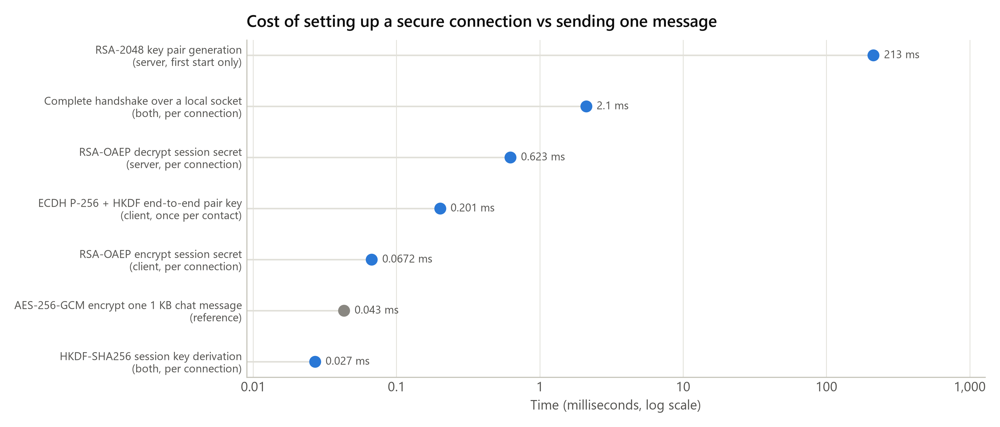

### 4.5 PBKDF2-HMAC-SHA256 password hashing

| Rounds | Time per password | Guesses per second per CPU core |
| --- | ---: | ---: |
| 1,000 | 0.09 ± 0.00 ms | 10,538 |
| 10,000 | 0.71 ± 0.09 ms | 1,400 |
| 50,000 | 3.40 ± 0.09 ms | 294 |
| 100,000 | 6.80 ± 0.15 ms | 147 |
| 200,000 ← SecureChat | 13.51 ± 0.20 ms | 74 |
| 500,000 | 34.74 ± 2.96 ms | 29 |
| 1,000,000 | 68.74 ± 0.58 ms | 15 |

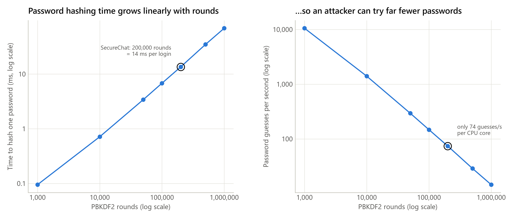

### 4.6 CPU and memory while encrypting

| Mode | Throughput | CPU (one core) | CPU (whole machine) | Peak memory (extra) |
| --- | ---: | ---: | ---: | ---: |
| AES-GCM | 1,012 MB/s | 100% | 6.2% | 77.1 MB (+2.0 MB) |
| AES-CBC + HMAC | 386 MB/s | 101% | 6.3% | 77.1 MB (+2.0 MB) |
| AES-CTR | 1,641 MB/s | 97% | 6.1% | 76.1 MB (+1.0 MB) |
| AES-ECB (insecure) | 1,936 MB/s | 99% | 6.2% | 77.1 MB (+2.0 MB) |

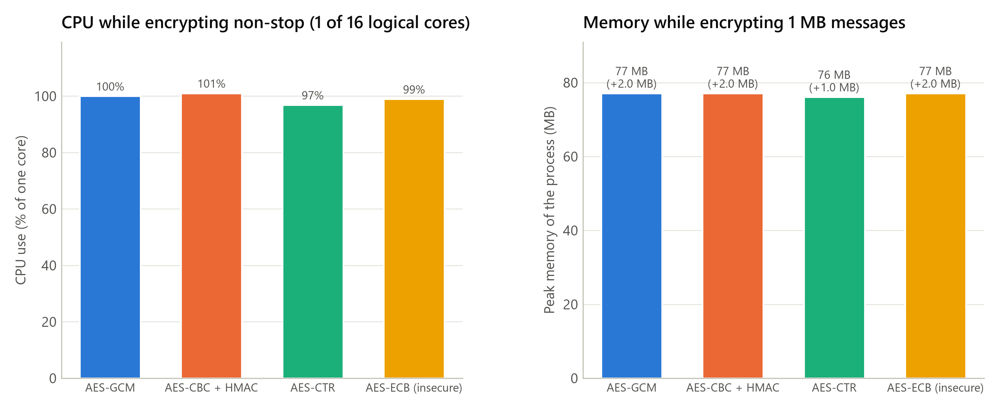

### 4.7 Network: one PC (localhost)

**Connection set-up** (median):

| Step | System | Median | Mean ± std dev |
| --- | --- | ---: | ---: |
| TCP connect | Plaintext | 0.10 ms | 0.10 ± 0.02 ms |
| TCP connect + RSA-OAEP/HKDF handshake | SecureChat | 1.96 ms | 1.99 ± 0.08 ms |
| Login (PBKDF2 password check on the server) | SecureChat | 21.23 ms | 21.06 ± 2.20 ms |

**Round trip client → server → client** (mean ± std dev):

| Message | SecureChat | Plaintext | Extra time | Extra % | SecureChat 95th pct |
| --- | ---: | ---: | ---: | ---: | ---: |
| 16 B | 0.684 ± 0.235 ms | 0.030 ± 0.017 ms | +0.654 ms | +2185% | 1.21 ms |
| 64 B | 0.626 ± 0.193 ms | 0.028 ± 0.014 ms | +0.598 ms | +2105% | 1.08 ms |
| 256 B | 0.717 ± 0.241 ms | 0.029 ± 0.015 ms | +0.688 ms | +2347% | 1.26 ms |
| 1 KB | 0.692 ± 0.236 ms | 0.033 ± 0.020 ms | +0.659 ms | +2003% | 1.26 ms |
| 4 KB | 0.832 ± 0.260 ms | 0.062 ± 0.020 ms | +0.770 ms | +1245% | 1.38 ms |
| 8 KB | 0.718 ± 0.189 ms | 0.063 ± 0.022 ms | +0.656 ms | +1049% | 1.07 ms |

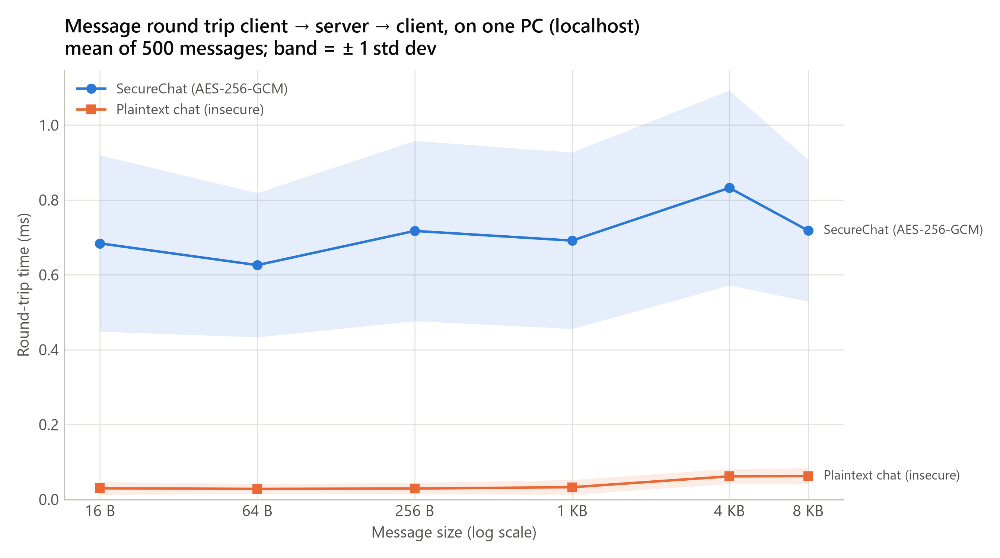

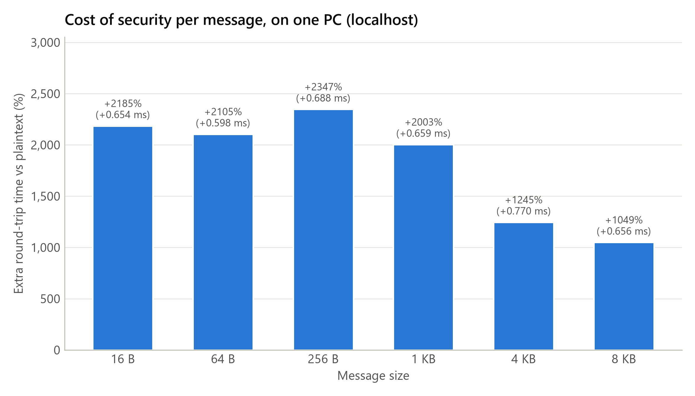

**Throughput** (2,000 messages sent back to back) and **file transfer** (sent and received back, SHA-256 verified):

| Test | SecureChat | Plaintext |
| --- | ---: | ---: |
| 64 B messages | 2,273 msg/s (0.1 MB/s) | 51,814 msg/s (3.2 MB/s) |
| 1 KB messages | 1,754 msg/s (1.7 MB/s) | 54,521 msg/s (53.2 MB/s) |
| 8 KB messages | 1,893 msg/s (14.8 MB/s) | 23,182 msg/s (181.1 MB/s) |
| 1 MB file | 0.03 s (38.3 MB/s) | 0.02 s (63.5 MB/s) |
| 10 MB file | 0.21 s (46.9 MB/s) | 0.13 s (76.0 MB/s) |
| 25 MB file | 0.58 s (43.4 MB/s) | 0.31 s (81.3 MB/s) |

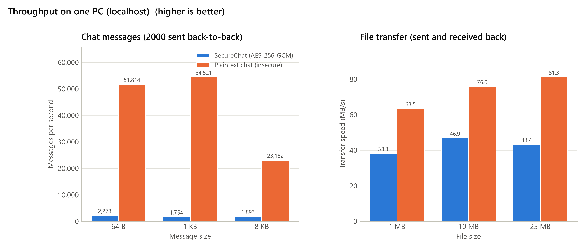

**Scalability** (every client chats non-stop for 3 s):

| Clients | SecureChat mean | SecureChat 95th pct | SecureChat msg/s | SecureChat server CPU | SecureChat server memory | Plaintext mean | Plaintext msg/s | Plaintext server CPU |
| --- | ---: | ---: | ---: | ---: | ---: | ---: | ---: | ---: |
| 1 | 0.66 ms | 1.25 ms | 1,465 | 77% | 78 MB | 0.03 ms | 27,037 | 45% |
| 5 | 3.55 ms | 4.82 ms | 1,405 | 182% | 79 MB | 0.09 ms | 48,647 | 229% |
| 10 | 7.70 ms | 10.47 ms | 1,299 | 192% | 79 MB | 0.22 ms | 42,806 | 224% |
| 25 | 19.81 ms | 25.93 ms | 1,265 | 181% | 82 MB | 0.55 ms | 44,333 | 224% |
| 50 | 37.76 ms | 45.58 ms | 1,329 | 187% | 86 MB | 1.08 ms | 45,446 | 224% |

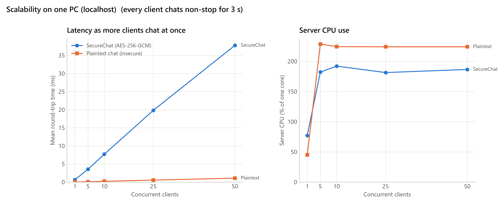

### Two PCs over the LAN - not run yet

Run `python -m performance.benchmark_network --serve` on the server PC and `python -m performance.benchmark_network --remote <server-ip>` on the other PC, then `python -m performance.make_report` to add the results here.

## 5. Analysis

### 5.1 Why AES-256-GCM is the right choice

GCM is **not** the fastest mode at every size, and the numbers show where it loses:

* **Small messages:** GCM needs 44 µs to encrypt a 1 KB message against 24 µs for CBC + HMAC. Most of that is a fixed cost of setting up a new GCM object in PyCryptodome for each message (it takes 41 µs even for 16 bytes). From 16 KB upwards GCM is the faster of the two.
* **Large messages and files:** at 1 MB GCM encrypts at 1,015 MB/s, 2.6× the speed of CBC + HMAC (388 MB/s), because it encrypts and authenticates in one pass instead of running AES-CBC and then a separate SHA-256 HMAC.
* **CTR and ECB are faster** (1,664 and 1,941 MB/s at 1 MB) but give **no integrity**: an attacker can flip bits in CTR ciphertext and the receiver cannot tell, and ECB encrypts identical 16-byte blocks to identical ciphertext, leaking patterns. Neither is acceptable for a chat that must reject tampered messages.

GCM wins on what matters for this application:

1. **Authenticated encryption (AEAD).** One primitive gives confidentiality *and* integrity: the 16-byte tag makes any modification detectable. The tamper demo (`security_demo/tamper_test.py`) relies on exactly this. Associated data binds each packet to its direction (`SecureChat/1|C2S` / `|S2C`) without encrypting it.
2. **Fewer ways to get it wrong.** CBC + HMAC is secure only when the MAC is checked before decrypting (encrypt-then-MAC) with a separate key; mistakes here have produced real padding-oracle attacks. GCM has no padding at all.
3. **Smaller packets.** 28 bytes of overhead per message against 64 for CBC + HMAC.
4. **It is the standard.** GCM is specified by NIST (SP 800-38D) and is one of the AEAD modes allowed by TLS 1.3, which permits only AEAD ciphers.

The ~20 µs GCM loses on a 1 KB message is invisible next to a network round trip (section 5.2), so it is a good trade for built-in integrity.

**Key size:** at 1 MB, AES-256 is within 8% of AES-128 in every mode. The CPU's AES instructions (AES-NI) do the extra rounds of AES-256 (14 instead of 10) in hardware, so the larger key costs almost nothing here.

### 5.2 The overhead of encryption, and whether users notice it

**One PC (localhost):** a 1 KB message takes 0.692 ms with SecureChat against 0.033 ms in plain text - +2003% or 0.66 ms extra. Across all message sizes the extra time stays between 0.60 and 0.77 ms, i.e. it is a roughly fixed cost per message. A 25 MB file takes 0.58 s instead of 0.31 s.

On one PC the percentage is large only because the plaintext baseline is tiny: the plaintext chat does nothing but copy bytes inside the same computer, while each SecureChat message is encrypted or decrypted eight times on its trip (client encrypt → server decrypt → server encrypts the ACK, the forwarded message and the DELIVERED receipt → client decrypts all three), and the server also validates it and looks up the recipient.

*The two-PC measurement has not been run yet, so the overhead over a real network is not reported here; run `python -m performance.benchmark_network --remote <server-ip>` and regenerate this report.*

**Noticeable?** About 100 ms is the commonly cited limit for a response to feel instantaneous (Nielsen, *Usability Engineering*, 1993). The largest extra time measured per message is 0.77 ms - about 130 times smaller than that, so users cannot perceive it. Files take measurably longer (one PC (localhost): +0.27 s for a 25 MB file), which matters only for the largest files.

### 5.3 The RSA handshake is paid once per session

* A complete handshake (RSA-OAEP key transport + HKDF + key confirmation) takes **2.10 ms** - the same time as encrypting about 49 1 KB messages with AES-GCM. It happens once per connection; every message after that uses only the symmetric session key.
* The most expensive cryptographic step is the server's RSA private-key operation (0.62 ms) - about 9× slower than the client's public-key encryption (0.067 ms). That asymmetry is why RSA is used only to transport one 32-byte secret, never to encrypt messages.
* Generating the server's RSA-2048 key pair takes 213 ms (± 102 ms - it depends on how quickly random primes are found) but happens only on the server's first start; the key is then saved encrypted.
* One PC (localhost): connecting takes 1.96 ms with the handshake against 0.10 ms for plain TCP; that is about 3 message round trips, once per session. Logging in takes another 21 ms, of which about 14 ms is the server's PBKDF2 check (section 4.5).

### 5.4 The PBKDF2 trade-off

PBKDF2 time grows linearly with the number of rounds (0.09 ms at 1,000 rounds, 68.7 ms at 1,000,000). The same cost that a legitimate login pays once is paid by an attacker for *every guess*:

* **The user:** 13.5 ms per login at SecureChat's 200,000 rounds - unnoticeable.
* **An attacker with a stolen database:** 74 guesses per second per CPU core instead of 10,538 at 1,000 rounds. Trying a list of 10,000 common passwords against one account takes 135 s per core instead of 0.9 s, and the per-user salt means this work cannot be reused for the next account. A random 8-letter lower-case password (26⁸ possibilities) would take about 89 core-years.
* **Caveat:** attackers use GPUs, which compute PBKDF2-SHA256 far faster than one CPU core, so these figures show the *relative* gain from more rounds, not an absolute guarantee. Strong passwords still matter.
* **Online attacks** are limited separately: the server locks an account for 60 s after 5 wrong passwords (see `security_demo/bruteforce_login_test.py`).
* **Choosing the number:** the OWASP Password Storage Cheat Sheet currently recommends 600,000 rounds for PBKDF2-HMAC-SHA256. From the measured line, 600,000 rounds would cost about 42 ms per login on this machine - still unnoticeable - so raising `PBKDF2_ITERATIONS` from 200,000 is a cheap improvement (existing hashes store their round count, so old accounts keep working).

### 5.5 Scalability

**One PC (localhost):**

* The SecureChat server handles 1,265-1,465 messages per second whether 1 or 50 clients are chatting, so with more clients each one waits its turn: latency grows almost linearly, by about 0.76 ms per extra active client (0.66 ms → 37.76 ms).
* Server CPU levels off at 192% of one core (out of 16 logical cores). Python's global interpreter lock lets only one thread run Python code at a time, so the thread-per-client server cannot use the other cores; the share above 100% is time spent in C code (PyCryptodome, sockets) that runs outside that lock.
* The plaintext relay reaches 48,647 messages per second - the difference is the per-message work of security (eight AES-GCM operations, validation, receipts).
* Memory grows from 78 MB to 86 MB (about 177 KB per extra connected client).
* **In practice:** if all 50 users were very active and each sent a message every two seconds, the server would need 25 messages per second, about 2% of the measured capacity; at that rate the measured capacity would serve roughly 2,530 such users. Going further would need several server processes (or a language without a GIL), since more threads in one Python process cannot use more cores.

On the client side, continuous AES-GCM encryption keeps one core busy (100% of one core = 6.2% of the machine) and needs only 2.0 MB of extra memory, while a normal chat encrypts only a few messages per second.

## 6. Limitations

* **One machine.** The crypto results come from a single laptop. Its CPU mixes performance and efficiency cores and changes its turbo clock, so repeated runs differ by several percent; the standard deviations in the tables show the spread.
* **Python.** Absolute speeds reflect Python + PyCryptodome. The fixed per-call cost (e.g. creating a GCM object) would be much smaller in C, Go or Rust, and the GIL limits the server to about one core for Python code.
* **The plaintext baseline is simpler than SecureChat.** It has no login, no database lookup and no receipts, so the network overhead measures *the whole secure protocol*, not AES alone. Section 4.1 isolates the pure encryption cost.
* **Simulated users.** Users message themselves and send as fast as possible; real users are much slower and burstier. Scalability was measured up to 50 clients.
* **Transport encryption only.** The network benchmark has end-to-end encryption switched off (the simulated users have no identity keys); E2E adds one ECDH key agreement per contact (measured in 4.4) and one more AES-GCM operation at each end.
* **PBKDF2 guesses are CPU figures**; GPUs and dedicated hardware are much faster.
* **No two-PC results yet.** All network numbers are on one PC, where there is no real network delay, no Wi-Fi interference and no packet loss. They show the *processing* cost of security, not what users would see over Wi-Fi.

## 7. Conclusion

AES-256-GCM provides confidentiality and integrity at 1,015 MB/s for large data on this laptop. Its fixed per-message cost of a few tens of microseconds in PyCryptodome makes it slower than CBC + HMAC on tiny messages, but that difference is far too small to matter. The RSA-2048 handshake costs 2.1 ms once per connection, and PBKDF2 with 200,000 rounds costs 14 ms per login while slowing password guessing to 74 guesses per second per core.

End to end on one PC (localhost), the full secure protocol adds 0.66 ms to a 1 KB message - about 152 times below the 100 ms a person can notice - and one Python server process sustains about 1,265 messages per second. **For the users of a chat application, the cost of security is effectively invisible.** The main improvements left are raising PBKDF2 to the currently recommended 600,000 rounds and, for many simultaneous users, a server that can use more than one CPU core.

## 8. Reproducing these results

```
python -m performance.benchmark_crypto                       # ~2 minutes
python -m performance.benchmark_network                      # ~1 minute, one PC
python -m performance.benchmark_network --serve              # on the server PC ...
python -m performance.benchmark_network --remote <server-ip> # ... and on the other PC
python -m performance.make_report                            # rewrite this report
```
